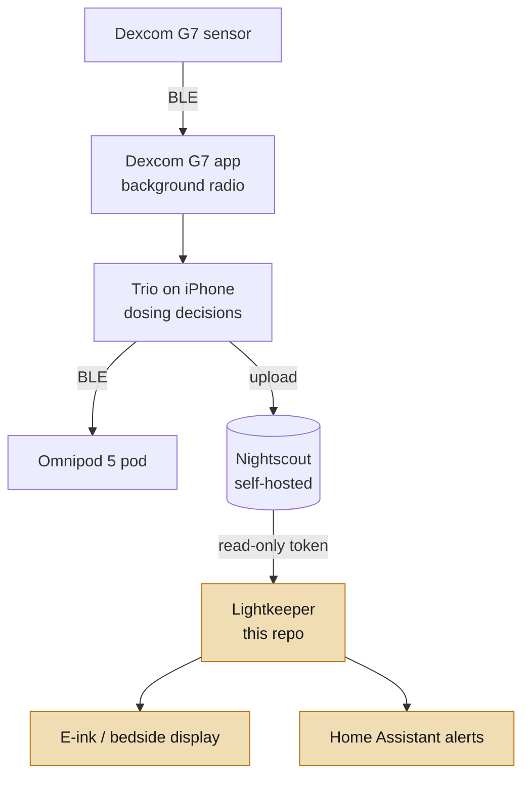

# Lightkeeper

<!-- CONSTITUTION_START -->
[](https://github.com/esanacore/engineering-constitution)
<!-- CONSTITUTION_END -->

**Version [0.1.0](https://github.com/esanacore/lightkeeper/releases/tag/v0.1.0)** · [Changelog](CHANGELOG.md) · [Roadmap](docs/ROADMAP.md)

An open source type 1 diabetes management stack, built by Eric and Kaitlin alongside the #WeAreNotWaiting community. It wires together existing community projects (Trio, Nightscout) around Kaitlin's real setup, a Dexcom G7 and Omnipod 5 pods on an iPhone, and adds our own read-only hardware and software layer on top: e-ink displays, bedside alerts, and Home Assistant integration.

> **Safety first.** Nothing in this repository sends commands to an insulin pump or a sensor. Insulin dosing is handled only by Trio, an established community project, configured with Kaitlin's care team. Everything we build here is a *secondary, read-only display* and is not a medical device. Always confirm on the primary CGM app before acting. See [`docs/SAFETY.md`](docs/SAFETY.md).

## Current Capabilities

- `lightkeeper`: reads the latest glucose from a self-hosted Nightscout site using a read-only token, and turns it into a short plain-text status (IN RANGE, LOW, URGENT LOW, HIGH, URGENT HIGH, STALE, NO DATA) sized for a small e-ink screen.
- Old or future-dated readings always show as **STALE - DO NOT TRUST**, never as a current number.
- If Nightscout goes down, the display degrades to the last good reading, which then ages into STALE on its own instead of freezing.
- Exit code `0` means in range and fresh, `1` means someone should look, so scripts like Home Assistant can react.
- `--demo` mode runs with canned data and no network at all.
- `--svg screen.svg` saves each screen as an image of the e-paper panel, for dashboards or previews. Every possible screen is pictured in [`docs/DISPLAY_STATES.md`](docs/DISPLAY_STATES.md).
- Firmware groundwork for an Xteink X4/X3 pocket e-ink display: the same safety rules in C++, proven identical to the Python version by shared test vectors.
- An iOS companion app (read-only layer): the same rules in Swift, verified against the same vectors on GitHub's macOS runners, with the Nightscout token kept in the Keychain.

## How It Fits Together



<details>
<summary>Diagram source (Mermaid)</summary>



</details>

The top half is community software we configure and test. The highlighted boxes, after Nightscout, are what this repository builds. Data only flows down into our code. Details in [`docs/ARCHITECTURE.md`](docs/ARCHITECTURE.md).

## Quick Start

**Supported platforms:** Windows 11 (PowerShell 7), macOS 14+, Ubuntu 22.04+ (and Raspberry Pi OS Bookworm for display builds). Requires Python 3.11 or newer. CI runs on Ubuntu.

```bash
git clone --recurse-submodules https://github.com/esanacore/lightkeeper
cd lightkeeper
```

<details>
<summary>Windows (PowerShell)</summary>

```powershell
py -3.11 -m venv .venv
.\.venv\Scripts\Activate.ps1
pip install -e ".[dev]"
```

</details>

<details>
<summary>macOS (zsh)</summary>

```bash
python3 -m venv .venv
source .venv/bin/activate
pip install -e ".[dev]"
```

</details>

<details>
<summary>Linux / Raspberry Pi (bash)</summary>

```bash
python3 -m venv .venv
source .venv/bin/activate
pip install -e ".[dev]"
```

</details>

## Run

Try it with no Nightscout at all (same on every platform):

```bash
python -m lightkeeper --demo
python -m lightkeeper --demo --demo-mgdl 62
python -m lightkeeper --demo --demo-minutes-ago 40
```

The first command prints the screen an e-ink panel would show and exits 0:

```text
IN RANGE
112 mg/dL ->
3 min ago
```

Against a real Nightscout site, set the environment variables from [`docs/ENV_VARS.md`](docs/ENV_VARS.md), then:

```bash
python -m lightkeeper            # print once, exit 0 or 1
python -m lightkeeper --watch    # refresh every 60 seconds until Ctrl+C
```

Use a Nightscout token with the **readable** role only, never your API_SECRET.

## Test

Same on every platform:

```bash
python tools/doctor.py          # checks prerequisites and names anything missing
python -m pytest --cov
make -C firmware/xteink test   # needs g++ and make (Linux, macOS, or WSL on Windows)
```

The Python suite enforces a 90% coverage floor (currently 100%). Both suites run every case in `spec/display_vectors.json`. The full suite, including ruff, strict mypy, and clang-format, is listed in [`docs/TEST_PLAN.md`](docs/TEST_PLAN.md). Test names carry the requirement IDs they verify, for example `test_fr003_staleness_beats_urgent_low`.

## Demo

See every display state with simulated data, no install needed: [live demo](https://esanacore.github.io/lightkeeper/), or open [`demo.html`](demo.html) locally.

## Project Structure

<details>
<summary>Full project structure</summary>

```text
lightkeeper/
├── src/lightkeeper/
│   ├── domain/          ← Pure rules: parsing, thresholds, staleness (no I/O)
│   ├── application/     ← Fetch, classify, render for a display
│   ├── infrastructure/  ← Read-only HTTPS Nightscout client, SVG panel renderer
│   └── cli.py           ← Command-line entry point
├── tests/               ← Pytest suite, named by requirement ID
├── spec/                ← Shared golden display vectors
├── firmware/xteink/     ← ESP32-C3 pocket e-ink display (C++)
├── apps/ios/            ← Swift core package and SwiftUI companion app
├── tools/               ← Prerequisite check and display-gallery generator
├── docs/                ← Requirements, architecture, safety, security, ADRs, setup, hardware, brand, display gallery
├── assets/brand/        ← Mark, app icon, palette, social preview
├── assets/diagrams/     ← README diagram source and its rendered image
├── wiki/                ← Wiki source pages
├── demo.html            ← Offline demo of every display state
└── constitution/        ← Eric's Engineering Constitution (git submodule)
```

</details>

## Documentation

- Safety boundary and hazard analysis: `docs/SAFETY.md`; the sign-off sheet for thresholds: `docs/SAFETY_REVIEW.md`
- Security model, data classification, and threat model: `docs/SECURITY_MODEL.md`
- Every display state, pictured: `docs/DISPLAY_STATES.md`
- What the community says about displays and alerts, and what we take from it: `docs/COMMUNITY_RESEARCH.md`
- Setup for Nightscout, Trio, and this repo: `docs/SETUP.md`
- What hardware to buy for the displays: `docs/HARDWARE.md`
- Brand guide, mark, palette, and type: `docs/BRAND.md`
- Roadmap and how the project grows: `docs/ROADMAP.md`, `docs/MVP_BACKLOG.md`, `TODO.md`
- Changelog: `CHANGELOG.md`
- Architecture and decisions: `docs/ARCHITECTURE.md`, `docs/adr/README.md`
- Product requirements and traceability: `docs/PRODUCT_REQUIREMENTS.md`, `docs/REQUIREMENTS_TRACEABILITY.md`
- Third-party software inventory: `docs/OTS_SOFTWARE.md`

## Contributing

See `CODE_OF_CONDUCT.md` and `SUPPORT.md`. Before completing work:

- Update tests, named with the requirement IDs they verify.
- Update documentation, including per-platform instructions.
- Update TODO.md and CHANGELOG.md.
- Review security and safety impact against `docs/SAFETY.md`. Any change that could affect what number a person sees needs a hazard review.

## License

Apache-2.0. See `LICENSE`.
