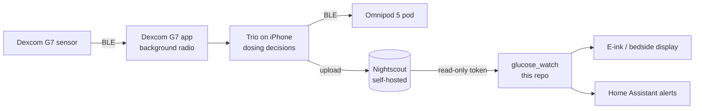

# t1d-open-stack

<!-- CONSTITUTION_START -->
[](https://github.com/esanacore/engineering-constitution)
<!-- CONSTITUTION_END -->

An open source type 1 diabetes management stack, built by Eric and Kaitlin alongside the #WeAreNotWaiting community. It wires together existing community projects (Trio, Nightscout) around Kaitlin's real setup, a Dexcom G7 and Omnipod 5 pods on an iPhone, and adds our own read-only hardware and software layer on top: e-ink displays, bedside alerts, and Home Assistant integration.

> **Safety first.** Nothing in this repository sends commands to an insulin pump or a sensor. Insulin dosing is handled only by Trio, an established community project, configured with Kaitlin's care team. Everything we build here is a *secondary, read-only display* and is not a medical device. Always confirm on the primary CGM app before acting. See [`docs/SAFETY.md`](docs/SAFETY.md).

## Current Capabilities

- `glucose_watch`: reads the latest glucose from a self-hosted Nightscout site using a read-only token, and turns it into a short plain-text status (IN RANGE, LOW, URGENT LOW, HIGH, URGENT HIGH, STALE, NO DATA) sized for a small e-ink screen.
- Old or future-dated readings always show as **STALE - DO NOT TRUST**, never as a current number.
- If Nightscout goes down, the display degrades to the last good reading, which then ages into STALE on its own instead of freezing.
- Exit code `0` means in range and fresh, `1` means someone should look, so scripts like Home Assistant can react.
- `--demo` mode runs with canned data and no network at all.
- Firmware groundwork for an Xteink X4/X3 pocket e-ink display: the same safety rules in C++, proven identical to the Python version by shared test vectors.

## How It Fits Together



The left half is community software we configure and test. The right half, after Nightscout, is what this repository builds. Data only flows rightward into our code. Details in [`docs/ARCHITECTURE.md`](docs/ARCHITECTURE.md).

## Quick Start

**Supported platforms:** Windows 11 (PowerShell 7), macOS 14+, Ubuntu 22.04+ (and Raspberry Pi OS Bookworm for display builds). Requires Python 3.11 or newer. CI runs on Ubuntu.

```bash
git clone --recurse-submodules <repository-url> t1d-open-stack
cd t1d-open-stack
```

<details>
<summary>Windows (PowerShell)</summary>

```powershell
py -3.11 -m venv .venv
.\.venv\Scripts\Activate.ps1
pip install -e ".[dev]"
```

</details>

<details>
<summary>macOS (zsh)</summary>

```bash
python3 -m venv .venv
source .venv/bin/activate
pip install -e ".[dev]"
```

</details>

<details>
<summary>Linux / Raspberry Pi (bash)</summary>

```bash
python3 -m venv .venv
source .venv/bin/activate
pip install -e ".[dev]"
```

</details>

## Run

Try it with no Nightscout at all (same on every platform):

```bash
python -m glucose_watch --demo
python -m glucose_watch --demo --demo-mgdl 62
python -m glucose_watch --demo --demo-minutes-ago 40
```

Against a real Nightscout site, set the environment variables from [`docs/ENV_VARS.md`](docs/ENV_VARS.md), then:

```bash
python -m glucose_watch            # print once, exit 0 or 1
python -m glucose_watch --watch    # refresh every 60 seconds until Ctrl+C
```

Use a Nightscout token with the **readable** role only, never your API_SECRET.

## Test

Same on every platform:

```bash
python -m pytest --cov
make -C firmware/xteink test   # needs g++ and make (Linux, macOS, WSL, Git Bash)
```

The Python suite enforces a 90% coverage floor (currently 100%). Both suites run every case in `spec/display_vectors.json`. Test names carry the requirement IDs they verify, for example `test_fr003_staleness_beats_urgent_low`.

## Demo

Open [`demo.html`](demo.html) to see every display state with simulated data, no install needed.

## Project Structure

<details>
<summary>Full project structure</summary>

```text
t1d-open-stack/
├── src/glucose_watch/
│   ├── domain/          ← Pure rules: parsing, thresholds, staleness (no I/O)
│   ├── application/     ← Fetch, classify, render for a display
│   ├── infrastructure/  ← Read-only HTTPS Nightscout client
│   └── cli.py           ← Command-line entry point
├── tests/               ← Pytest suite, named by requirement ID
├── spec/                ← Shared golden display vectors
├── firmware/xteink/     ← ESP32-C3 pocket e-ink display (C++)
├── docs/                ← Requirements, architecture, safety, ADRs, setup
├── wiki/                ← Wiki source pages
├── demo.html            ← Offline demo of every display state
└── constitution/        ← Eric's Engineering Constitution (git submodule)
```

</details>

## Documentation

- Safety boundary and hazard analysis: `docs/SAFETY.md`
- Setup for Nightscout, Trio, and this repo: `docs/SETUP.md`
- Roadmap: `TODO.md` and `docs/MVP_BACKLOG.md`
- Changelog: `CHANGELOG.md`
- Architecture and decisions: `docs/ARCHITECTURE.md`, `docs/adr/`
- Product requirements and traceability: `docs/PRODUCT_REQUIREMENTS.md`, `docs/REQUIREMENTS_TRACEABILITY.md`
- Third-party software inventory: `docs/OTS_SOFTWARE.md`

## Contributing

Before completing work:

- Update tests, named with the requirement IDs they verify.
- Update documentation, including per-platform instructions.
- Update TODO.md and CHANGELOG.md.
- Review security and safety impact against `docs/SAFETY.md`. Any change that could affect what number a person sees needs a hazard review.

## License

Apache-2.0. See `LICENSE`.
