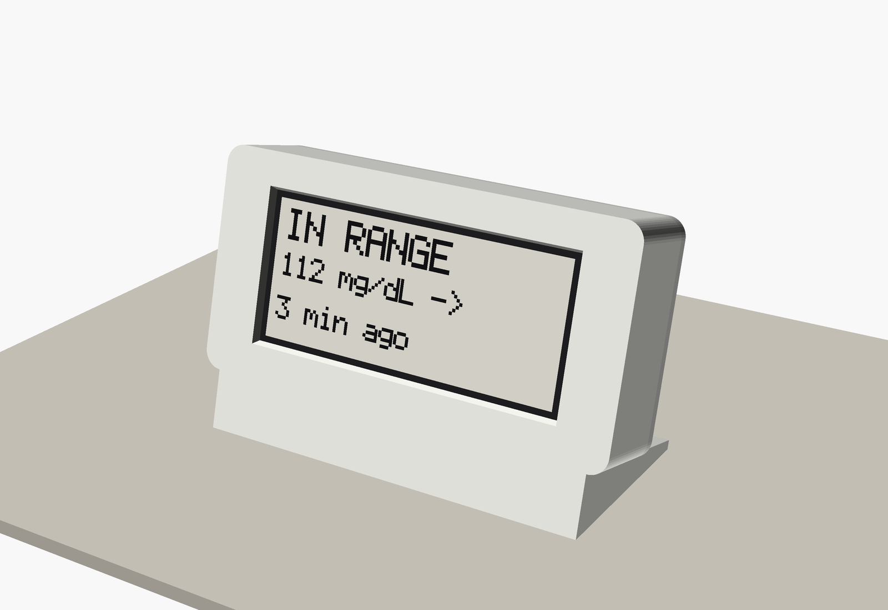
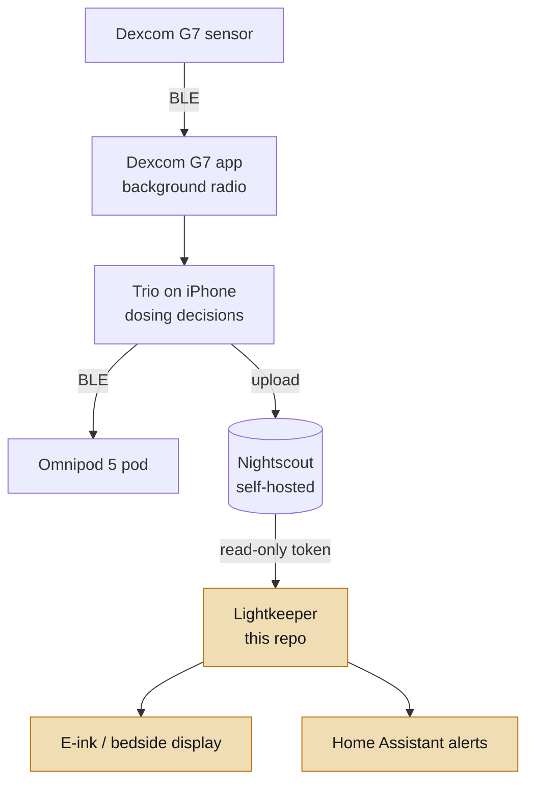

# Lightkeeper

<!-- CONSTITUTION_START -->
[](https://github.com/esanacore/engineering-constitution)
<!-- CONSTITUTION_END -->

**Version [0.2.0](https://github.com/esanacore/lightkeeper/releases/tag/v0.2.0)** · [Changelog](CHANGELOG.md) · [Roadmap](docs/ROADMAP.md)

An open source type 1 diabetes management stack, built by Eric and Kaitlin alongside the #WeAreNotWaiting community. It wires together existing community projects (Trio, Nightscout) around Kaitlin's real setup, a Dexcom G7 and Omnipod 5 pods on an iPhone, and adds our own read-only hardware and software layer on top: e-ink displays, bedside alerts, and Home Assistant integration.

> **Safety first.** Nothing in this repository sends commands to an insulin pump or a sensor. Insulin dosing is handled only by Trio, an established community project, configured with Kaitlin's care team. Everything we build here is a *secondary, read-only display* and is not a medical device. Always confirm on the primary CGM app before acting. See [`docs/SAFETY.md`](docs/SAFETY.md).

## Current Capabilities



The bedside display, rendered from its enclosure's CAD model; the screen is drawn by the same code the Pi runs. Build it with [`docs/ASSEMBLY.md`](docs/ASSEMBLY.md).

- `lightkeeper`: reads the latest glucose from a self-hosted Nightscout site using a read-only token, and turns it into a short plain-text status (IN RANGE, LOW, URGENT LOW, HIGH, URGENT HIGH, STALE, NO DATA) sized for a small e-ink screen.
- Old or future-dated readings always show as **STALE - DO NOT TRUST**, never as a current number.
- If Nightscout goes down, the display degrades to the last good reading, which then ages into STALE on its own instead of freezing. When it fails, one line on stderr names the link that failed and the setting to check, once per change; the screen still shows only the vector lines.
- Exit code `0` means in range and fresh, `1` means someone should look, `2` a setting that cannot be used (the message names it) or a file a one-shot run could not write, and `130` a one-shot run stopped with Ctrl+C, so scripts, cron and Home Assistant never read an interrupted run as fresh.
- Home Assistant over MQTT discovery: four sensors (level, glucose, reading age, and the time of the last reading) that go `unavailable` if the publisher stops and never show a number for a stale reading. `--json PATH` writes the same status, which never carries a negative age, for dashboards.
- `--demo` mode runs with canned data and no network at all; the `--demo-*` options work only with `--demo`.
- `--watch` in an interactive terminal redraws one screen in place inside a plain ASCII logbook frame, with reverse video, underline and strike so the status reads without color (`--no-color`, `NO_COLOR`); piped or under systemd it prints exactly the screen lines.
- `--svg screen.svg` saves each screen as an image of the e-paper panel in the brand's colors with each status's 1-bit shape, and `--png` or `--bmp` write the exact 1-bit panel pixels for the panel `--panel` names, stamped with the local time they were drawn. Every possible screen is pictured in [`docs/DISPLAY_STATES.md`](docs/DISPLAY_STATES.md).
- Raspberry Pi bedside display groundwork: an integer-only 1-bit panel layout that gives every status a shape as well as its word and draws at six panel sizes, pinned pixel for pixel by `spec/panel_vectors.json`; a hardened systemd service with a watchdog; and a printable enclosure with renders, STLs, and a bill of materials ([`docs/BOM.md`](docs/BOM.md)). The panel driver waits for the hardware.
- Firmware groundwork for an Xteink X4/X3 pocket e-ink display: the same safety rules in C++, proven identical to the Python version by shared test vectors, plus a heap-free, fuzzed parser for Nightscout's responses. The ESP32 firmware rasterizer (`firmware/xteink/lib/panel_bitmap`) draws the same 1-bit panel pixels as the Python reference at all six profiles, and a build-only device skeleton for the bench ESP32-S3 and the Xteink X4 prints the NO DATA panel over USB serial; nothing is drawn on a panel yet.
- An iOS companion app (read-only layer): the same rules in Swift, verified against the same vectors on GitHub's macOS runners, with the Nightscout token kept in the Keychain. On STALE it shows no big number: the banner is the largest text and the old value appears only struck through. It starts from a setup card, checks the connection in plain words, and reads the screen to VoiceOver in the same sentences as the spoken vectors. The glance timeline a future widget will draw from, with STALE scheduled ahead, is in place.
- One spoken sentence per screen for screen readers (`spec/spoken_vectors.json`), the same in Python and Swift, never more current than the screen and never sent to Home Assistant.
- Brand tokens in one machine-readable file (`assets/brand/tokens.json`) that the iOS app, the demo, the SVG panel and the terminal frame are tested against, with measured contrast for every color; the new Keeper's Logbook tokens await Eric's approval.

## How It Fits Together


<details>
<summary>Diagram source (Mermaid)</summary>



</details>

The top half is community software we configure and test. The highlighted boxes, after Nightscout, are what this repository builds. Data only flows down into our code. Details in [`docs/ARCHITECTURE.md`](docs/ARCHITECTURE.md).

## Quick Start

**Supported platforms:** Windows 11 (PowerShell 7), macOS 14+, Ubuntu 22.04+ (and Raspberry Pi OS Bookworm for display builds). Requires Python 3.11 or newer. CI runs on Ubuntu.

```bash
git clone --recurse-submodules https://github.com/esanacore/lightkeeper
cd lightkeeper
```

<details>
<summary>Windows (PowerShell)</summary>

```powershell
py -3.11 -m venv .venv
.\.venv\Scripts\Activate.ps1
pip install -e ".[dev]"
```

</details>

<details>
<summary>macOS (zsh)</summary>

```bash
python3 -m venv .venv
source .venv/bin/activate
pip install -e ".[dev]"
```

</details>

<details>
<summary>Linux / Raspberry Pi (bash)</summary>

```bash
python3 -m venv .venv
source .venv/bin/activate
pip install -e ".[dev]"
```

</details>

## Run

Try it with no Nightscout at all (same on every platform):

```bash
python -m lightkeeper --demo
python -m lightkeeper --demo --demo-mgdl 62
python -m lightkeeper --demo --demo-mgdl 62 --demo-trend SingleDown
python -m lightkeeper --demo --demo-minutes-ago 40
```

The first command prints the screen an e-ink panel would show and exits 0:

```text
IN RANGE
112 mg/dL ->
3 min ago
```

Against a real Nightscout site, set the environment variables from [`docs/ENV_VARS.md`](docs/ENV_VARS.md), then:

```bash
python -m lightkeeper            # print once, exit 0 or 1
python -m lightkeeper --watch    # refresh every 60 seconds until Ctrl+C
```

In a terminal, `--watch` redraws one framed screen in place; `--no-color` (or `NO_COLOR`) keeps its shapes without color. `--png panel.png --panel 800x480` writes the exact panel pixels with a local `HH:MM` stamp. Exit codes are `0` (fresh and in range), `1` (someone should look), `2` (a setting that cannot be used, named in the message, or a file a one-shot run could not write) and `130` (a one-shot run stopped with Ctrl+C). The `--demo-*` options need `--demo`. Every option is in [`docs/COMMAND_REFERENCE.md`](docs/COMMAND_REFERENCE.md).

Use a Nightscout token with the **readable** role only, never your API_SECRET.

## Test

Same on every platform:

```bash
python tools/doctor.py          # checks prerequisites and names anything missing
python -m pytest --cov
make -C firmware/xteink test   # needs g++ and make (Linux, macOS, or WSL on Windows)
node --test web/panel/panel.test.mjs  # the demo's panel port (Node 20 or later)
```

The Python suite enforces a 100% line and branch coverage floor. The Python suite and the firmware host tests run every case in `spec/display_vectors.json` and `spec/response_vectors.json`, and with the demo's JavaScript port they hold the panel pixels to `spec/panel_vectors.json`. The full suite, including ruff, strict mypy, and clang-format, is listed in [`docs/TEST_PLAN.md`](docs/TEST_PLAN.md). Test names carry the requirement IDs they verify, for example `test_fr003_staleness_beats_urgent_low`.

## Demo

See every display state with simulated data, no install needed: [live demo](https://esanacore.github.io/lightkeeper/), or open [`demo.html`](demo.html) locally. It draws the real 1-bit panel pixels in the browser at six panel sizes, with deep links such as `#stale_beats_urgent_low`.

## Project Structure

<details>
<summary>Full project structure</summary>

```text
lightkeeper/
├── src/lightkeeper/
│   ├── domain/          ← Pure rules: parsing, thresholds, staleness (no I/O)
│   ├── application/     ← Fetch, classify, render for a display
│   ├── infrastructure/  ← Read-only HTTPS Nightscout client, MQTT, SVG and panel renderers, terminal frame
│   └── cli.py, config.py ← Command-line entry point and settings
├── tests/               ← Pytest suite, named by requirement ID
├── spec/                ← Shared display, response, spoken and panel-pixel vectors; the Keeper 5x8 font
├── firmware/xteink/     ← ESP32 pocket e-ink display (C++): rules, parser, panel rasterizer, device skeleton
├── apps/ios/            ← Swift core package and SwiftUI companion app
├── tools/               ← Prerequisite check; gallery, BOM, pinout, corpus, panel, spoken, demo and brand-pixel generators; render tools
├── docs/                ← Requirements, architecture, safety, security, ADRs, setup, hardware, brand, display gallery
├── assets/brand/        ← Mark, app icon, palette, social preview, tokens, pixel icons
├── assets/diagrams/     ← README diagram source and its rendered image
├── deploy/              ← Hardened systemd service for a Pi display
├── hardware/            ← BOM data, parametric enclosure (OpenSCAD), renders, STLs
├── wiki/                ← Wiki source pages
├── web/panel/           ← The demo's panel port and its Node tests
├── demo.html            ← Offline demo of every display state
└── constitution/        ← Eric's Engineering Constitution (git submodule)
```

</details>

## Documentation

- Safety boundary and hazard analysis: `docs/SAFETY.md`; the sign-off sheet for thresholds: `docs/SAFETY_REVIEW.md`
- Security model, data classification, and threat model: `docs/SECURITY_MODEL.md`
- Every display state, pictured: `docs/DISPLAY_STATES.md`
- What the community says about displays and alerts, and what we take from it: `docs/COMMUNITY_RESEARCH.md`
- Setup for Nightscout, Trio, and this repo: `docs/SETUP.md`
- What hardware to buy for the displays: `docs/HARDWARE.md`; bill of materials: `docs/BOM.md`; printing and assembly with CAD renders: `docs/ASSEMBLY.md`, `hardware/`
- Brand guide, mark, palette, type, and the Keeper's Logbook tokens: `docs/BRAND.md`, `assets/brand/tokens.json`
- Roadmap and how the project grows: `docs/ROADMAP.md`, `docs/MVP_BACKLOG.md`, `TODO.md`
- Changelog: `CHANGELOG.md`
- Architecture and decisions: `docs/ARCHITECTURE.md`, `docs/adr/README.md`
- Product requirements and traceability: `docs/PRODUCT_REQUIREMENTS.md`, `docs/REQUIREMENTS_TRACEABILITY.md`
- Third-party software inventory: `docs/OTS_SOFTWARE.md`

## Contributing

See `CODE_OF_CONDUCT.md` and `SUPPORT.md`. Before completing work:

- Update tests, named with the requirement IDs they verify.
- Update documentation, including per-platform instructions.
- Update TODO.md and CHANGELOG.md.
- Review security and safety impact against `docs/SAFETY.md`. Any change that could affect what number a person sees needs a hazard review.

## License

Apache-2.0. See `LICENSE`.
