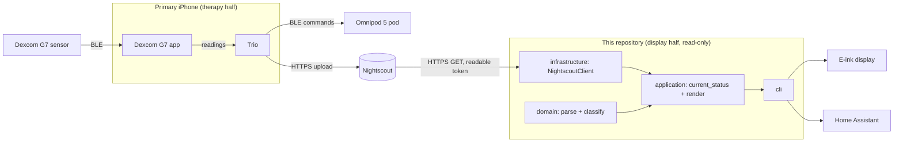

# Architecture

This document describes how the whole stack is wired, and how the code in this repository is organized.

## System Overview

The stack has two halves with a one-way boundary between them.

The **therapy half** is community software running on the person with diabetes's iPhone: the Dexcom G7 app (kept only as a Bluetooth radio), Trio (the open source automated insulin delivery app, built from source), and Omnipod 5 pods paired to Trio. Trio uploads glucose, insulin, and loop status to Nightscout. We configure, test, and contribute upstream to these projects, but no code for them lives here.

The **display half** is what this repository builds: read-only consumers of Nightscout data, starting with `lightkeeper`, which renders a short status for e-ink screens, bedside displays, and Home Assistant.

Data only flows from the therapy half into the display half. Nothing in the display half can write to Nightscout treatments, Trio, the pump, or the sensor. See `docs/SAFETY.md`.

## Component Diagram

## Data Flow

1. The G7 sends a reading every 5 minutes to the Dexcom G7 app; Trio reads it on the same phone.
2. Trio runs its algorithm, commands the pod, and uploads glucose entries to Nightscout.
3. `lightkeeper` requests the newest entries from `/api/v1/entries/sgv.json` with a read-only token.
4. The domain layer drops anything untrustworthy, picks the newest valid reading, and classifies it. Staleness is evaluated before range.
5. The application layer renders a few short ASCII lines and returns an exit code; on fetch failure it re-classifies the last good reading against the current time so it ages into STALE.

Glucose data is **Restricted** (health data) at every step of this flow, and the readable token is Confidential. The classification of each store and boundary-crossing flow, plus the STRIDE threat model, are in `docs/SECURITY_MODEL.md`.

## Key Technologies

- **Therapy (external):** Trio (Swift, OpenAPS oref algorithm), Dexcom G7 app, Omnipod 5 pods via Trio's OmnipodKit driver (v1.0.0+)
- **Data hub (external, self-hosted):** Nightscout (Node.js, MongoDB)
- **This repo:** Python 3.11+, standard library only at runtime; pytest and pytest-cov for tests
- **Companion app:** Swift 5.9, SwiftUI, iOS 17+, built on GitHub macOS runners via XcodeGen; token in the Keychain
- **Display targets:** Xteink X4/X3 pocket e-ink (ESP32-C3, C++17, rules done, device build pending), Raspberry Pi with an e-paper HAT, Home Assistant

## Repository Structure

- `src/lightkeeper/domain/`: pure rules, no I/O, no clock.
- `src/lightkeeper/application/`: use cases that combine a data source with the domain rules.
- `src/lightkeeper/infrastructure/`: the HTTPS Nightscout client.
- `src/lightkeeper/cli.py`: composition root, wires env config, clock, and client.
- `tests/`: pytest suite, test names carry requirement IDs.
- `spec/display_vectors.json`: golden display cases every implementation must pass.
- `firmware/xteink/`: C++17 port of the domain rules for the ESP32-C3 pocket display, with host tests.
- `apps/ios/`: Swift package with the same rules and a read-only Nightscout client, plus the SwiftUI companion app (ADR-0008, read-only layer).
- `docs/`: requirements, safety, ADRs, setup.
- `constitution/`: universal engineering rules (git submodule).

## Layer Boundaries

| Layer          | Path                              | May Depend On |
| -------------- | --------------------------------- | ------------- |
| domain         | src/lightkeeper/domain          | --            |
| application    | src/lightkeeper/application     | domain        |
| infrastructure | src/lightkeeper/infrastructure  | domain        |

The domain layer stays free of I/O so that every safety rule in `docs/SAFETY.md` can be tested with plain data and a fixed clock.
