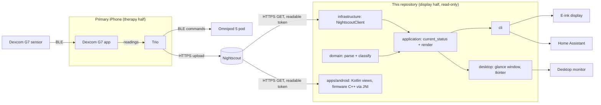
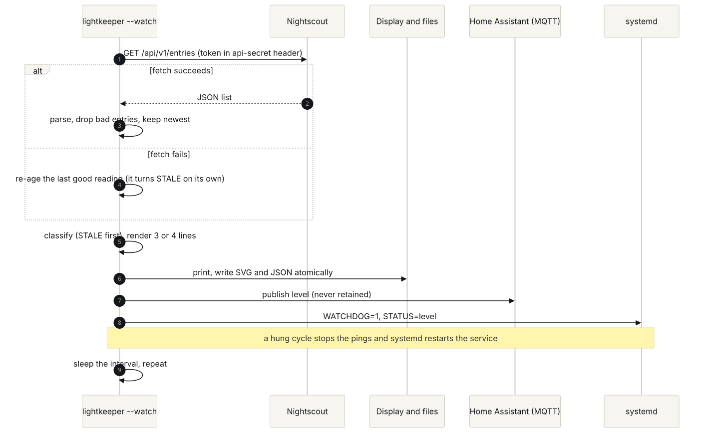

# Architecture

This document describes how the whole stack is wired, and how the code in this repository is organized.

## System Overview

The stack has two halves with a one-way boundary between them.

The **therapy half** is community software running on the person with diabetes's iPhone: the Dexcom G7 app (kept only as a Bluetooth radio), Trio (the open source automated insulin delivery app, built from source), and Omnipod 5 pods paired to Trio. Trio uploads glucose, insulin, and loop status to Nightscout. We configure, test, and contribute upstream to these projects, but no code for them lives here.

The **display half** is what this repository builds: read-only consumers of Nightscout data, starting with `lightkeeper`, which renders a short status for e-ink screens, bedside displays, a desktop window, and Home Assistant, and read-only iOS and Android companion apps.

Data only flows from the therapy half into the display half. Nothing in the display half can write to Nightscout treatments, Trio, the pump, or the sensor. See `docs/SAFETY.md`.

## Component Diagram

## Deployment

Where each piece runs and what crosses each boundary. The highlighted boxes are what this repository builds; everything reads Nightscout with a readable token and nothing writes back.

## One Refresh Cycle

## Data Flow

1. The G7 sends a reading every 5 minutes to the Dexcom G7 app; Trio reads it on the same phone.
2. Trio runs its algorithm, commands the pod, and uploads glucose entries to Nightscout.
3. `lightkeeper` requests the newest entries from `/api/v1/entries/sgv.json` with a read-only token.
4. The domain layer drops anything untrustworthy, picks the newest valid reading, and classifies it. Staleness is evaluated before range.
5. The application layer renders a few short ASCII lines and returns an exit code; on fetch failure it re-classifies the last good reading against the current time so it ages into STALE.

The desktop window runs step 3 on a worker thread, so a slow Nightscout never freezes it: answers come back through a queue that Tk's thread polls every 250 ms, from Tk's `after()` and from a ticker thread on the monotonic clock (so a clock set back cannot stall it), and steps 4 and 5 run there. A re-age timer redraws at the next instant the lines can change, at least every 30 seconds. The Android app fetches with `HttpsURLConnection` and hands the raw body to the firmware's C++ (`lk::newest_reading_from_json`, `lk::classify`, `lk::render`, `lk::render_panel`) through JNI.

Glucose data is **Restricted** (health data) at every step of this flow, and the readable token is Confidential. The classification of each store and boundary-crossing flow, plus the STRIDE threat model, are in `docs/SECURITY_MODEL.md`. On the phone the token is held only as AES-256-GCM ciphertext in app-private storage, under a key the Android Keystore never exports; readings stay in memory and are never written to storage.

## Key Technologies

- **Therapy (external):** Trio (Swift, OpenAPS oref algorithm), Dexcom G7 app, Omnipod 5 pods via Trio's OmnipodKit driver (v1.0.0+)
- **Data hub (external, self-hosted):** Nightscout (Node.js, MongoDB)
- **This repo:** Python 3.11+, standard library only at runtime; pytest and pytest-cov for tests
- **Companion app:** Swift 5.9, SwiftUI, iOS 17+, built on GitHub macOS runners via XcodeGen; token in the Keychain
- **Display targets:** Xteink X4/X3 pocket e-ink (ESP32-C3, C++17: rules, JSON parser and panel rasterizer done; a build-only PlatformIO skeleton prints the NO DATA panel over USB serial; Wi-Fi and the panel driver pending), Raspberry Pi with an e-paper HAT, Home Assistant
- **Desktop window:** tkinter from the standard library (Tcl/Tk 8.6, from the Python installation: `python3-tk` on Linux), imported only when the window opens
- **Android app:** Kotlin with framework Views (no AndroidX, Compose or third-party library in the APK beyond the Kotlin standard library and its annotations), the firmware's C++17 through JNI (NDK 28.2.13676358, CMake 3.22.1, no C++ runtime), AGP 9.1.1 with its built-in Kotlin, Gradle 9.5.1, compileSdk and targetSdk 36, minSdk 26; a sideloaded debug APK of about 1 MB
- **Web demo:** one HTML file with no build step; Node 20 or later only to test its panel port

## Repository Structure

- `src/lightkeeper/domain/`: pure rules, no I/O, no clock.
- `src/lightkeeper/application/`: use cases that combine a data source with the domain rules, the status payload shared by `--json` and Home Assistant (version 2), and the spoken form (`spoken.py`, FR-017), a use case that depends only on the domain, and the desktop window's glance (`glance.py`, FR-018): its state on an injected clock, the window title (every part but the clock verbatim from the lines), when to look again, wall-clock jumps and the fetch watchdog; it imports the domain and `monitor.py` beside it.
- `src/lightkeeper/infrastructure/`: the HTTPS Nightscout client (each failure carries a kind and a plain-words hint), the publish-only MQTT client and Home Assistant discovery publisher (`mqtt.py`, `home_assistant.py`, ADR-0010), the SVG panel renderer (`svg_display.py`, the panel's 1-bit shapes in brand colors), the interactive `--watch` logbook frame (`terminal_view.py`: ASCII, SGR codes that mirror `assets/brand/tokens.json` and are held to it by a test, no application imports), and the 1-bit panel rasterizer: `panel_layout.py` (the integer-only layout plan and the status treatment table), `panel_profiles.py` (the six named panel sizes and `resolve()`, which uses `panel_layout.check_size`), and `epaper_bitmap.py` with the project's own 5x8 font (`font5x7.py`, named Keeper 5x8), which writes PNG and 1-bit BMP images with an opt-in `HH:MM` stamp, the packed rows `spec/panel_vectors.json` hashes, and the Waveshare panel buffer for the Raspberry Pi display (FR-007; the SPI driver waits for hardware); the desktop window's Tk adapter (`tk_window.py`, which takes the tkinter module as a parameter and never imports it) and `ppm.py`, which turns a panel bitmap into P6 PPM at a whole-number zoom in Paper and Ink or Night paper and Night ink.
- `src/lightkeeper/cli.py`, `src/lightkeeper/config.py` and `src/lightkeeper/desktop.py`: the composition roots. `config.py` reads and checks every setting from the environment once and raises `ConfigError` naming the variable and the clash (exit 2); `cli.py` wires the settings, clock and client to the screen (plain lines, or the `--watch` frame on a terminal) and the file outputs; `desktop.py` wires the same settings, a fetch worker thread, a ticker thread and tkinter (imported only when the window opens) to the glance and the window, and is installed as the `lightkeeper-window` gui script (D12, pending Eric's review).
- `src/lightkeeper/infrastructure/systemd_notify.py`: sd_notify (ready, watchdog, status) for the systemd service.
- `hardware/`: the bill of materials (`bom/bom.csv`, rendered to `docs/BOM.md`) and the parametric bedside enclosure (`enclosure/bedside.scad`) with its renders and STLs.
- `deploy/lightkeeper.service`: the hardened systemd unit for a Pi display, checked against the CLI by `tests/test_deploy.py`.
- `tests/`: pytest suite, test names carry requirement IDs.
- `spec/display_vectors.json`: golden display cases every implementation must pass.
- `spec/response_vectors.json`: raw Nightscout responses and the conclusion every implementation must reach (built by `tools/gen_response_corpus.py`).
- `spec/spoken_vectors.json`: the screen-reader sentence for every display vector (built by `tools/gen_spoken_vectors.py`), checked by Python and Swift.
- `spec/panel_vectors.json` and `spec/font5x8.json`: the 1-bit panel of every display vector at six panel sizes, pinned by CRC-32, and the Keeper 5x8 font (built by `tools/gen_panel_spec.py`), checked by Python, the firmware and the demo.
- `firmware/xteink/`: C++17 for the ESP32 pocket display. `lib/glucose_rules` (the domain rules), `lib/nightscout_json` (a heap-free Nightscout JSON parser) and `lib/panel_bitmap` (the panel rasterizer) are pure libraries: no Arduino, no heap, integers only, all host-tested. `src/serial_panel.cpp` is plain C++ that the host tests build: `draw_offline_screen` wires nightscout_json -> glucose_rules -> panel_bitmap for the no-network screen, and `print_panel` turns the image into `#`/`.` lines through a callback. `src/main.cpp` is the device composition root and the only code that includes `Arduino.h`; it hands `print_panel` a function that calls `Serial.println`, then deep sleeps. `platformio.ini` builds it for the bench ESP32-S3 (`bench_s3`) and the X4 (`x4`); nothing is drawn on a panel yet.
- `apps/ios/`: Swift package with the same rules and a read-only Nightscout client, plus the SwiftUI companion app (ADR-0008, read-only layer). `LightkeeperCore` also holds the spoken form, the phone's glance hierarchy (`Presentation.swift`) and the glance timeline a future widget will draw from (`GlanceTimeline.swift`, FR-019).
- `apps/android/`: the read-only Android companion app (FR-020). `app/src/main/cpp/CMakeLists.txt` compiles `firmware/xteink/lib` (`glucose_rules`, `nightscout_json`, `panel_bitmap`) in place by path, and `jni_bridge.cpp` is the only C++ the app owns, so there is no fourth rules implementation. `app/src/main/java/com/esanacore/lightkeeper/` holds framework Views in Kotlin (`GlanceController.kt` runs the fetch and re-age timers, `Presentation.kt` the phone hierarchy, `TokenStore.kt` the sealed token); `app/src/test/` holds the JVM unit tests and `app/src/androidTest/` the instrumented tests. It is not a declared Python layer, so `check_architecture.sh` does not read it; `tests/test_android.py` checks it from the Python suite.
- `web/panel/`: the demo's integer-only JavaScript panel port (`panel.js`), copied into `demo.html` by `tools/gen_demo_panel.py`, with its Node tests (`panel.test.mjs`).
- `assets/brand/tokens.json`: the one machine-readable source for brand colors, held to `docs/BRAND.md` and to every surface by tests (NFR-005).
- `docs/`: requirements, safety, ADRs, setup.
- `constitution/`: universal engineering rules (git submodule).

## Layer Boundaries

| Layer          | Path                              | May Depend On |
| -------------- | --------------------------------- | ------------- |
| domain         | src/lightkeeper/domain          | --            |
| application    | src/lightkeeper/application     | domain        |
| infrastructure | src/lightkeeper/infrastructure  | domain        |

`cli.py`, `config.py` and `desktop.py` are the composition roots, outside the layers. `application/glance.py` imports `application/monitor.py`, in its own layer, as `status_payload.py` does; a layer may import itself. On the firmware, `src/main.cpp` is the device's composition root. The Android app sits outside the Python layers.

The domain layer stays free of I/O so that every safety rule in `docs/SAFETY.md` can be tested with plain data and a fixed clock.
