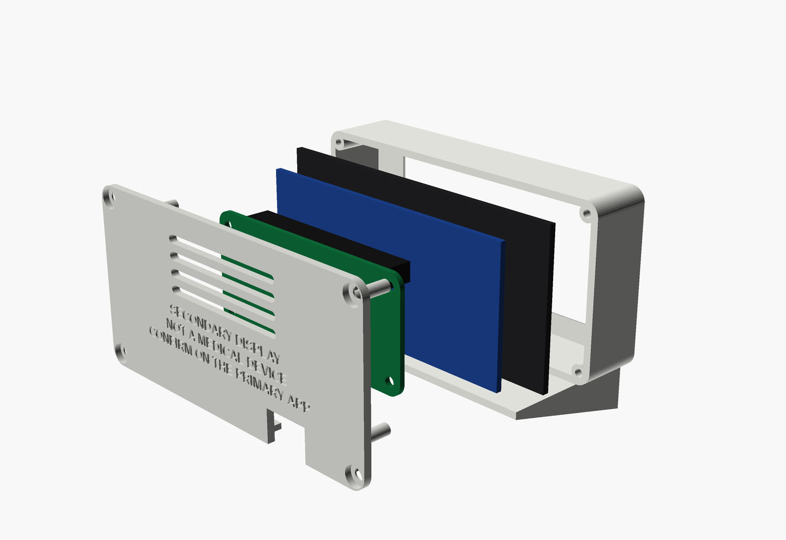
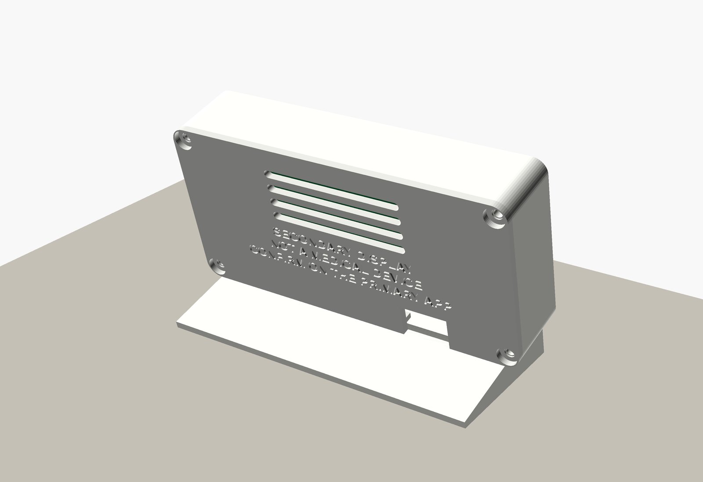
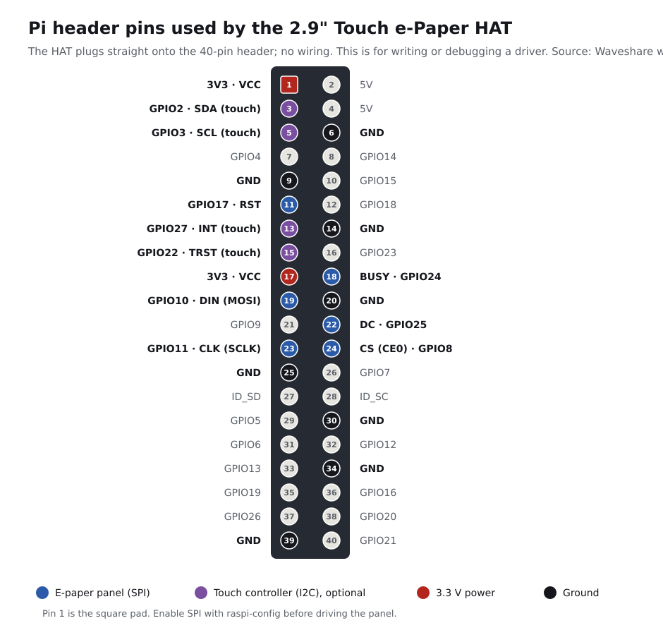

# Assembling the Bedside Display

How to build the bedside display: a Raspberry Pi Zero 2 WH and a Waveshare 2.9" Touch e-Paper HAT in a two-part printed enclosure that stands at a 15 degree lean.


The screen in these renders is not a mock-up. It is drawn from the same rasterizer and font the Pi uses (`tools/render_enclosure.py`), so it shows exactly what the panel will show.

Nothing here is a medical device. The display is secondary and read-only; the primary CGM app and its alarms stay on the phone (`docs/SAFETY.md`). The back cover carries that message, engraved so it cannot peel off.

## What you need

- The parts in the **Bedside display** section of `docs/BOM.md`: the Pi Zero 2 WH, the 2.9" Touch e-Paper HAT, a 5 V 2.5 A supply, a **right-angle micro-USB cable**, a 32 GB microSD card, the two printed parts, and four M2.5 x 8 mm self-tapping screws.
- A 3D printer that takes 95 x 60 mm parts, PETG or PLA filament, a small Phillips screwdriver, and calipers.

## Before the final print: measure four things

The enclosure is parametric (`hardware/enclosure/bedside.scad`). The official drawings give most dimensions; four do not, and the model marks them `VERIFY`. Print the bezel once as a test, then measure and adjust if needed.

| Parameter | Default | What to measure |
| --- | --- | --- |
| `glass[2]` | 1.8 mm | Thickness of the HAT's glass at its edge. Too thin and the glass rattles; too thick and the back cover will not close. |
| `header_gap` | 8.5 mm | Distance from the back of the HAT's blue PCB to the top of the Pi when the two are plugged together. |
| `pi_offset` | 0, 0 | Where the Pi sits relative to the centre of the glass when plugged in. Used only for the renders, since nothing in the case touches the Pi. |
| `cable_x`, `cable_notch` | 21.5; 13 x 7 mm | Where your right-angle plug body ends up, and its size. The notch in the back cover must clear it. |

Change a value at the top of `bedside.scad`, then export again (see the end of this page).

## Print settings

- **Material:** PETG for a bedside (it tolerates a warm windowsill); PLA works.
- **Layers:** 0.2 mm, 3 walls, 20 % infill. No supports.
- **Orientation:** both STLs are exported ready to print. The bezel prints face down, which gives the front a smooth finish. The back cover prints with its outer face down and the posts pointing up.
- **Mass:** about 30 to 35 g for the bezel (most of it the plinth) and about 10 g for the back at 20 % infill.

## Assembly


1. **Prepare the microSD card.** Flash Raspberry Pi OS Lite and install Lightkeeper as a service. `docs/SETUP.md`, "Bedside e-ink display", has the steps; do this before closing the case.
2. **Seat the display.** Hold the HAT by its edges and lower the glass, face first, into the pocket at the front of the bezel, with the HAT's header toward the top. The glass is held by the pocket, not by screws: the HAT has no mounting holes. Do not press on the display area.
3. **Plug in the Pi.** Line up pin 1 (the square pad, marked on the pinout below) and press the Pi straight onto the HAT's 40-pin header. The header carries the Pi; nothing else touches it.
4. **Connect the power cable.** Plug the right-angle micro-USB cable into the Pi's **PWR IN** port, the one nearest the board's corner, and lay the cable along the inside floor of the case toward the back.
5. **Close the back.** Set the back cover on, with the cable in its notch at the bottom edge. The four posts press the corners of the HAT's PCB forward so the glass stays seated. Drive the four M2.5 x 8 mm screws into the corner bosses until snug; do not over-tighten into plastic.
6. **Stand it up.** It rests on the plinth at a 15 degree lean, which suits reading from a pillow.





## Header pins

The HAT plugs straight on; no wiring. This diagram matters only if you write or debug the panel driver.



## First power-on and validation

1. Plug in the supply. The service starts by itself; `systemctl status lightkeeper` shows the current level in its Status line.
2. Before anyone relies on it, run it beside the primary app for one full sensor session and log every mismatch, freeze, or missed STALE (`docs/TEST_PLAN.md`, manual validation).
3. Every possible screen, as the panel will draw it, is in `docs/DISPLAY_STATES.md` ("Panel pixels" column).

## Sources for the dimensions

- Raspberry Pi Zero 2 W: official mechanical drawing RP-008358-DS-1 (outline 65 x 30 mm, holes 3.5 mm from the edges on a 58 x 23 mm pattern, ports on the bottom long edge).
- Waveshare 2.9inch Touch e-Paper HAT: Waveshare size drawing and wiki (glass 89.1 x 42.7 mm, driver PCB 79.5 x 37.5 mm, active area 66.89 x 29.05 mm, roughly centred; no mounting holes; pin table).
- Values not on those drawings are marked `VERIFY` in the model and listed above.

## Regenerating the renders and STLs

Needs OpenSCAD and Pillow:

```bash
python tools/render_enclosure.py
```

It rewrites `hardware/enclosure/renders/*.png`, `hardware/enclosure/stl/*.stl`, and `hardware/enclosure/manifest.json`. `tests/test_enclosure.py` fails if the model changed and the manifest was not regenerated.
