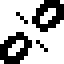
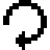
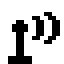
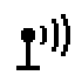

# Brand Guide

How Lightkeeper looks and sounds, so every screen, slide, and page reads as one project. Assets live in `assets/brand/`; the same tokens are published as a Design System artifact for decks and app mockups.

## The idea

A lighthouse watches all night and never steers the ship. The mark reduces that to geometry: one point of light and the sweep it casts, three concentric arcs inside a 60 degree sector (lens, beam, reach), held by a stem that stands in for the tower. No windows, no waves, no picture of a building. The beam always sweeps to the right, toward the next reading.

## Mark

| File | Use |
| --- | --- |
| `assets/brand/lightkeeper-mark.svg` | On light backgrounds (ink tower, amber lamp) |
| `assets/brand/lightkeeper-mark-dark.svg` | On dark backgrounds (paper tower, amber lamp) |
| `assets/brand/lightkeeper-mark-mono.svg` | Single color, inherits `currentColor`; for favicons, watch faces, e-ink |
| `assets/brand/lightkeeper-wordmark.svg` | Horizontal lockup, mark plus the name in Bricolage Grotesque |
| `assets/brand/app-icon.svg` | 1024 px iOS app icon source (night background, rounded by iOS) |
| `assets/brand/social-preview.svg` | 1280x640 GitHub social preview (upload in repository Settings) |
| `assets/brand/pixel-icons.json` | Pixel icons and pixel marks as `#`/`.` grids (see Icons and marks below) |
| `assets/brand/png/` | Rendered PNGs of the above; `tools/gen_brand_pixels.py` writes the `pixel-*.png` files |
| `assets/brand/tokens.json` | Every color token on this page, machine-readable, with the status map, 1-bit collapse, treatments, textures, theme slots, terminal codes and the proposals |

Rules: keep clear space of at least the lamp's diameter around the mark; the sweep keeps its three steps and its 60 degree angle; never recolor the lamp anything but Beam amber or the mono color; never add a face, a wave, a building, or a second beam; on e-ink use the mono mark in ink only. At 16 px, use the mono mark without the outer arc.

## Color

Two neutral families and one accent. Status colors are separate from the accent and always travel with a word.

| Token | Light theme | Dark theme | Role | Contrast on Fog (light / dark) |
| --- | --- | --- | --- | --- |
| Night | `#0E1116` | `#0E1116` | Dark background, app icon | 15.83 / 1.00 |
| Ink | `#15171C` | `#E6E5DF` (text) | Text on light, tower on light | 15.01 / 14.98 |
| Paper | `#E6E5DF` | `#DDDCD5` | E-ink panel color | 1.06 / 13.75 |
| Fog | `#ECEBE5` | `#0E1116` | Page background | 1.00 / 1.00 |
| Surface | `#F6F5F0` | `#161A21` | Cards and panels | 1.09 / 1.08 |
| Line | `#CFCDC4` | `#262B33` | Borders | 1.33 / 1.33 |
| Muted | `#5B6068` | `#9AA0A9` | Secondary text | 5.30 / 7.18 |
| Beam | `#B8730A` | `#E0A526` | Accent: eyebrows, links, the lamp | 3.20 / 8.63 |
| Beam soft | `#F1DDB4` | `#3A2E13` | Accent backgrounds | 1.12 / 1.42 |
| In range | `#2E6B4A` | `#6CC597` | Status | 5.30 / 9.07 |
| Low, urgent low | `#B3261E` | `#FF6B5E` | Status | 5.47 / 6.77 |
| High, urgent high | `#B86A00` | `#F5A341` | Status | 3.45 / 9.18 |
| Stale, no data | `#6B6F76` | `#9AA0A9` | Status | 4.23 / 7.18 |

The contrast column is the WCAG 2.2 ratio of each token against Fog, the page background, in the same theme, measured from the hex values by `tests/test_brand_tokens.py`. Backgrounds sit near 1:1 on purpose. Text needs 4.5:1; large text (24 px, or 18.66 px bold), borders that identify a control, and focus rings need 3:1. So Line (1.33) is for decorative dividers only, and light-theme Beam (3.20) is for the lamp, rules, focus rings and text of 24 px or more. Borders that identify a control use Line strong, and smaller accent text uses Beam text (both under Keeper's Logbook below).

Beam deep (`#B8730A`) is the accent on light backgrounds because the bright amber fails contrast on paper tones. Red and orange are kept apart in lightness, but only by 1.59:1 in the light theme and 1.36:1 in the dark, which is not enough to carry meaning: low and high never rely on hue alone, and every status is also printed as text and drawn with a shape.

## Type

- Display: Bricolage Grotesque, weights 600 to 800, tight tracking on large sizes.
- Body: IBM Plex Sans, 400 to 600.
- Data and panels: IBM Plex Mono. Everything an e-ink panel shows is monospace, and every digit column uses tabular numerals.

Scale: 12, 14, 16, 20, 28, 40, 64 px on screens; 24, 28, 32, 44, 72, 120 px on slides.

## Voice

Plain, calm, and specific. Short sentences. Say what the screen shows and how old it is. Never "alarm"; say "notice" or "nudge". Never medical advice. Every public surface carries one line: *Lightkeeper is a secondary display and not a medical device. Always confirm on the primary CGM app.*

## Photography and imagery

We don't use stock photos of people or of medical devices we didn't photograph. When we need imagery, we use our own photos of real displays on the bench or bedside, rendered panel images from `docs/DISPLAY_STATES.md`, and the mark. Hardware photos go in `assets/photos/` with the device and date in the file name.

## Keeper's Logbook

A lighthouse keeper wrote one line in a ruled book every watch, with the time beside it. Every Lightkeeper screen is that logbook. The data is plain: the status word, the number with its arrow, and the age sit on flat Paper or Surface. The frame is lo-fi and home-grown: the project's own pixel font, the real 1-bit panel pixels scaled by whole numbers, dashed ruled lines, rubber-stamp times, hard offset shadows, notched bezels, dither in the margins, and one amber lamp.

Five rules keep it calm by construction:

1. Texture lives in the margin; the truth lives in the middle. No pattern ever sits under text.
2. Shape before hue. Every status has its word plus a 1-bit shape. Color is only the second cue.
3. STALE is never the weakest thing on screen, and an old value is never the hero, at every panel size.
4. Anything that can outlive its writer says when it was written.
5. Nothing moves, blinks, ticks every second, or makes a sound. A change is one redraw, the way e-ink swaps an image.

Everything in this section is presentation only. Screen text still comes from `spec/display_vectors.json`, unchanged. All of it is new and awaits Eric's approval at review (D1): the tokens, the Keeper 5x8 name, the textures, the shadow and the icons. The two items under Proposed, not in use are written down for a decision, and no surface uses them.

### New tokens

| Token | Light theme | Dark theme | Use | Measured (light / dark) |
| --- | --- | --- | --- | --- |
| Line strong | `#7D7B74` | `#646C77` | Borders that identify a control, panel bezels, card edges | 3.55 on Fog, 3.36 on Paper, 3.88 on Surface / 3.56 on Night, 3.28 on Surface |
| Beam text | `#8C5800` | `#E0A526` | Links, eyebrows, and any accent text under 24 px | 5.01 on Fog, 4.74 on Paper, 5.48 on Surface / 8.63 on Night, 7.96 on Surface |
| In range chip | `#E4E6E0` | `#335D4A` | Tint behind the IN RANGE word | Ink 14.25, border 5.03 / Ink 5.93, border 3.59 |
| Low chip | `#EDE3DE` | `#783433` | Tint behind the LOW and URGENT LOW words | Ink 14.21, border 5.18 / Ink 7.12, border 3.22 |
| High chip | `#EDE6DE` | `#734D29` | Tint behind the HIGH and URGENT HIGH words | Ink 14.49, border 3.33 / Ink 5.89, border 3.61 |
| Stale chip | `#E7E6E2` | `#484C52` | Tint behind the STALE and NO DATA words | Ink 14.36, border 4.04 / Ink 6.84, border 3.28 |
| Night paper | `#1C1E22` | `#1C1E22` | Panel previews in dark mode, so the panel is never the brightest thing at the bedside | Night ink on it 8.30 |
| Night ink | `#B9B7AE` | `#B9B7AE` | Panel glyphs on Night paper | 8.30 on Night paper |

In dark mode, Beam text is Beam. Night paper and Night ink are the panel preview's colors in dark mode on iOS, the demo and the desktop window; in light mode the preview stays Paper and Ink. Line stays, for decorative dividers only.

### Status color as text

A status color is used as text only at large sizes: 24 px regular, or 18.66 px bold, and up. As small text, High (3.45:1) and Stale (4.23:1) fall short on Fog, so below that size the word is Ink on its chip.

A chip is the status word in Ink, on its chip tint, with a 2 px border in the status color and a 2 px radius. The word is never smaller than the number beside it.

### Shape grammar

Designed for the 1-bit panel first; screens mirror it. Each headline gets one treatment, keyed only by the headline, so the shape still says which kind of status it is with every color removed.

| Headline | Treatment | 1-bit panel | Screens |
| --- | --- | --- | --- |
| IN RANGE | `plain` | Plain headline | Ink word on its chip, 2 px green border until D2 is decided |
| LOW | `rule` | 2 px rule under the headline, full content width | Ink word on its chip, 2 px status border |
| HIGH | `rule` | 2 px rule under the headline, full content width | Ink word on its chip, 2 px status border |
| URGENT LOW | `inverse` | Inverse band: paper glyphs on ink, 2 px pad | Ink band, Paper text, 4 px status-color leading rule |
| URGENT HIGH | `inverse` | Inverse band: paper glyphs on ink, 2 px pad | Ink band, Paper text, 4 px status-color leading rule |
| STALE - DO NOT TRUST | `stale` | Inverse band, a 4 px hatch-45 frame inside the margin, and a strike through the `last:` line (1 px at scale 2 or less, 2 px at scale 3 and up) | Ink band, Paper text, hatch in the margin only, the `last:` line struck through |
| NO DATA | `dashed` | 2 px dashed frame (4 on, 4 off), no number | 2 px dashed Line strong frame, no number |
| Any other headline | `dashed` | The same as NO DATA, the most cautious treatment | The same as NO DATA |

Panel invariants, at every panel size:

- The headline band is the same height for every level at a given panel size.
- The value line may be the hero, but never above the headline scale, so the status word is never smaller than the number.
- The arrow is part of the value string, at the same scale.
- The age line is never below body scale, and the `last:` line on STALE is never above it.
- No texture under glyphs.

### 1-bit collapse

What each token becomes on a black and white panel, by its id in `assets/brand/tokens.json`. Backgrounds become paper and everything drawn on them becomes ink. Line becomes a 25% dither, used only inside frames.

| 1-bit | Tokens |
| --- | --- |
| paper | `night`, `paper`, `fog`, `surface`, `beam-soft`, `chip-in-range`, `chip-low`, `chip-high`, `chip-stale`, `night-paper` |
| ink | `ink`, `muted`, `beam`, `in-range`, `low`, `high`, `stale`, `line-strong`, `beam-text`, `night-ink` |
| dither-25 | `line` |

### Glance anatomy

Every surface shows the same things in the same order:

1. Status: the vector headline, verbatim.
2. The value line, with its arrow attached.
3. The age, in Ink, semibold or mono, never Muted or small grey print.
4. Context lines.
5. Chrome: the stamp and the disclaimer.

When space runs out, shrink the context first, then the hero number. Never shrink the status or the age.

### Keeper 5x8

Keeper 5x8 is the name for the project's own pixel font: the glyph table in `src/lightkeeper/infrastructure/font5x7.py`, five cells wide, seven rows for capitals and digits plus a descender row. The glyphs are unchanged.

- Integer scales only, never smoothed. On screens, only at 16, 24, 32, 48 or 64 px.
- Scale 2 or more for anything a person must read.
- Never for body copy, settings, disclaimers, or text that follows Dynamic Type or the system font scale. At accessibility text sizes it gives way to IBM Plex Mono.

### Space, shape and stamps

- Screens use a 4 px grid: 4, 8, 12, 16, 24, 32, 48, 64. E-ink margins are `max(4, (h*6+50)//100)`, integer math only.
- Radius is 2 px on screens and 0 on e-ink.
- Bezels are 2 px Line strong with notched corners stepped in 2 px. Cards are 1 px Line strong.
- Dividers are 1 px dashed Line, the ruled logbook. A major rule is 2 px Ink.
- The hard shadow is `3px 3px 0` in Beam soft (light) or Line (dark), on cards and buttons only, never on chips, bands or data.
- Touch targets are 44 px or larger. The focus ring is 2 px Beam with a 2 px offset. A pressed control is an Ink fill with Paper text.

A stamp is the time an image was drawn, not the time of the reading:

- Bitmap, PNG and BMP: `HH:MM` in local 24-hour time, in Keeper 5x8 at scale 2 or more on the age row. Always on for exported images and the desktop window; opt-in in the reference renderer until D3 decides whether physical panels show it.
- SVG: `written HH:MM UTC`, unchanged until D3 is decided.
- Terminal: `checked HH:MM:SS`. Desktop: `checked HH:MM` in the window title. iOS: `checked HH:MM` as an absolute time.
- Widget timelines schedule their own STALE entry.
- Demo panels carry `SIMULATED`.

### Texture

Margins, bezels, headers and empty states only, never under text. One cell is one CSS pixel, with an integer `background-size` and `image-rendering: pixelated`. Every texture is removed under `prefers-contrast: more`, `forced-colors: active` and print.

| Texture | Cells | Use |
| --- | --- | --- |
| dither-12 | `#... / .... / ..#. / ....` | 4x4 Bayer, 2 of 16 cells |
| dither-25 | `#. / ..` | 2x2, 1 of 4 cells; Line on the 1-bit panel |
| dither-50 | `#. / .#` | Checkerboard |
| hatch-45 | `...# / ..#. / .#.. / #...` | 1 px every 4 px, for the STALE frame only |

### Icons and marks

Pixel icons are 16x16 grids in `assets/brand/pixel-icons.json`, with 2-cell outline strokes and 1-cell detail (hatch, cut marks), shown here at 4x. An icon always sits beside a word and never replaces it, never resembles a trend arrow, and never animates.

| Icon | Name | Meaning |
| --- | --- | --- |
|  | `lamp-lit` | Fresh reading |
|  | `lamp-hatched` | Stale reading |
|  | `lamp-empty` | No reading, or an unknown headline |
|  | `cut-link` | Nightscout unreachable |
|  | `gear` | Settings |
|  | `refresh` | Check again now; its head points left along the circle, a direction no trend arrow uses |
|  | `mark-16` | The pixel mark at 16 px: two arcs, following the 16 px rule above |
|  | `mark-32` | The pixel mark at 32 px, on a 32x32 grid: three arcs in a 60 degree sweep to the right |

The three lamps share one outline and differ only inside the glass: lit, hatched or empty. `tools/gen_brand_pixels.py` renders every grid to `assets/brand/png/pixel-<name>.png` at 1x and `pixel-<name>@4x.png` at 4x with the panel's own 1-bit bitmap. The plain-text signature is `o)))`.

### Motion and sound

None. Every change is a single redraw. The one exception is an optional 120 ms `steps(3)` opacity change when someone switches state on the demo, removed under `prefers-reduced-motion`. Never a pulse, blink, spinner, flash, a simulated e-ink flash on an emissive screen, a caption that ticks every second, a bell, a sound, a notification, or a taskbar flash. Loading copy is static: `checking Nightscout...`.

### Terminal

Only an interactive terminal running `--watch` gets the logbook frame: clear and home, then redraw, under the header `o))) lightkeeper   checked HH:MM:SS`, in an ASCII `+ - |` frame with 2-space padding. Piped, systemd and `--json` output stays exactly the vector lines.

| Status | SGR with color | With `NO_COLOR` or `--no-color` |
| --- | --- | --- |
| IN RANGE | `32` | plain |
| LOW | `4;31` | `4` |
| HIGH | `4;33` | `4` |
| URGENT LOW | `1;7;31` | `1;7` |
| URGENT HIGH | `1;7;33` | `1;7` |
| STALE | `7`, with `9` (strike) on the `last:` line | `7`, with `9` on the `last:` line |
| NO DATA | `7` | `7` |
| Any other headline | `7` | `7` |

`NO_COLOR` and `--no-color` drop only the color codes (30 to 37) and keep reverse, underline and strike, so the meaning survives monochrome. `TERM=dumb` or a non-terminal gets no escape codes at all. Never dim (2), blink (5, 6) or bright black (90) for meaning, never the bell, and ASCII only. IN RANGE stays green until the IN RANGE neutral proposal below is decided.

### User themes

Desktop and terminal themes get four slots, and only four. Status colors are never themeable: they always travel with their word.

| Slot | Default token |
| --- | --- |
| background | `fog` |
| line | `line-strong` |
| foreground | `ink` |
| accent | `beam` |

### Proposed, not in use

Written down for a decision. No surface uses these until Eric decides.

#### IN RANGE neutral (D2)

On glance surfaces, IN RANGE would get an Ink border and no green, so color appears only for exceptions. Until decided, IN RANGE keeps its green.

#### Night profile (D15)

A darker profile for the bedside at night, on black. Every color is at least 4.5:1 on its background. Never a whole-UI red tint, because red means LOW.

| Night profile token | Value | On `#000000` |
| --- | --- | --- |
| Background | `#000000` | |
| Text | `#9A978F` | 7.20 |
| Beam | `#A88442` | 6.04 |
| Low | `#D0574C` | 5.15 |
| High | `#C7853A` | 6.84 |
| Stale | `#7E838B` | 5.51 |
| In range | `#4E9A74` | 6.20 |

### Calm-technology review checklist

Run this on every new surface before it ships:

- [ ] The status word is the vector headline, verbatim, and nothing on the surface is larger than it.
- [ ] The age sits beside the number in Ink, never Muted or small grey print.
- [ ] STALE is never the weakest thing on screen, and a stale value is never the hero.
- [ ] Every status has its word and its shape; the surface still reads in grayscale and in forced colors.
- [ ] An unknown or missing state falls to the NO DATA treatment, never to IN RANGE.
- [ ] Status colors sit outside every themeable slot.
- [ ] Text and data sit on flat Paper or Surface at 4.5:1 or better (7:1 is the target), with no texture under them.
- [ ] Colored status text appears only at 24 px, or 18.66 px bold, and up.
- [ ] Nothing moves, blinks, pulses, ticks every second or makes a sound, and `prefers-reduced-motion` is honored.
- [ ] No notification, bell, haptic, badge or taskbar flash.
- [ ] Anything that can outlive its writer carries a stamp.
- [ ] Icons sit beside a word, never replace one, and never resemble a trend arrow.
- [ ] Controls are 44 px or larger, with Line strong borders and a 2 px Beam focus ring.
- [ ] The surface says it is a secondary display and points to the primary CGM app.
- [ ] On the web: no third-party requests, cookies or tracking, and the demo stays one file of 512 KB or less.
- [ ] The surface's colors are tested against `assets/brand/tokens.json`.
