# Display States

Every screen Lightkeeper can show, drawn at the size of a 2.9" e-paper panel. These images are generated from `spec/display_vectors.json` by `tools/gen_display_gallery.py`, the same cases the Python, firmware, and Swift tests run, so they always match real behavior. Regenerate them after changing a vector.

Rules worth noticing: anything older than 15 minutes, or more than 2 minutes in the future, shows STALE, even when the number would be alarming; sensor out-of-range values show as words, not numbers; and the screen never uses more than four lines.

## Fresh readings

| Situation | Screen |
| --- | --- |
| sgv 112 mg/dL, Flat, 3 min old | 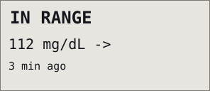 |
| sgv 150 mg/dL, SingleUp, 0 min old | 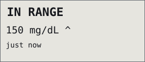 |
| sgv 70 mg/dL, FortyFiveDown, 1 min old | 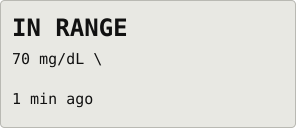 |
| sgv 69 mg/dL, SingleDown, 2 min old | 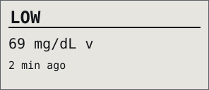 |
| sgv 55 mg/dL, DoubleDown, 1 min old | 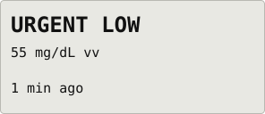 |
| sgv 39 mg/dL, NONE, 0 min old | 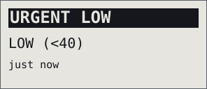 |
| sgv 180 mg/dL, Flat, 4 min old | 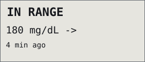 |
| sgv 181 mg/dL, FortyFiveUp, 4 min old | 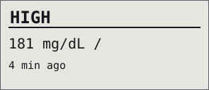 |
| sgv 250 mg/dL, DoubleUp, 2 min old |  |
| sgv 401 mg/dL, Flat, 0 min old | 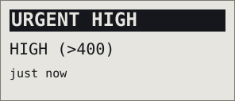 |
| sgv 130 mg/dL, SomethingNew, 5 min old | 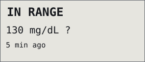 |

## Old or untrustworthy time

| Situation | Screen |
| --- | --- |
| sgv 120 mg/dL, Flat, 15 min old | 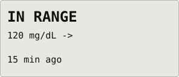 |
| sgv 120 mg/dL, Flat, 16 min old |  |
| sgv 45 mg/dL, SingleDown, 40 min old | 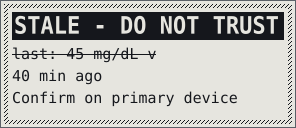 |
| sgv 120 mg/dL, Flat, 10 min in the future | 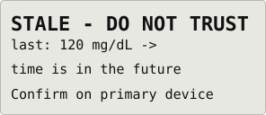 |
| sgv 120 mg/dL, Flat, 1 min in the future | 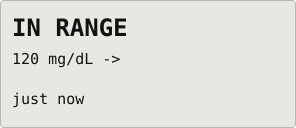 |

## Missing data and outages

| Situation | Screen |
| --- | --- |
| No reading in Nightscout |  |
| No reading in Nightscout, Nightscout unreachable | 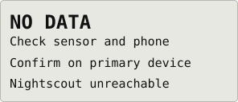 |
| sgv 101 mg/dL, Flat, 7 min old, Nightscout unreachable | 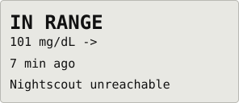 |
| sgv 120 mg/dL, Flat, 32 min old, Nightscout unreachable | 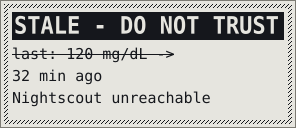 |
| sgv 402 mg/dL, Flat, 1 min old | 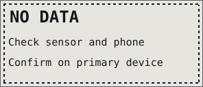 |
| sgv 1e+30 mg/dL, Flat, 1 min old |  |
| mbg 120 mg/dL, Flat, 1 min old |  |
