# Safety Boundary and Hazard Analysis

This project touches type 1 diabetes care for a real person. This document sets the hard boundary for what the repository may do, and records the hazards we have thought about. It is a lightweight analysis in the spirit of ISO 14971, not a regulatory submission, and nothing here is a medical device.

## Intended Use and Classification

Lightkeeper displays glucose values that have already been published to Nightscout, for awareness only. It is intended for a person with type 1 diabetes, and the people around them, who already run a CGM and its official app. It is not intended to diagnose, to alarm, or to inform a treatment decision: the primary CGM app and its alarms remain the sole source for action, and every Lightkeeper screen is documented to mean "confirm on the primary device."

Classification rationale. No Lightkeeper output drives therapy, and no code in this repository communicates with a pump or a sensor (see The Boundary). The worst-case failure of the software alone is a wrong or missing number on a secondary screen that always carries, in the device label, the CLI help, and the documentation, an instruction to confirm on the primary device. The project therefore treats itself as the equivalent of IEC 62304 Class A (no injury or damage to health is possible from a software failure alone), and it is not submitted, registered, or marketed as a medical device. Should any future feature change that reasoning (an alarm, or the bolus request path in ADR-0008), this section and the classification are re-evaluated first. Re-evaluated 2026-10-26 for the Home Assistant path (ADR-0010, HAZ-013): Lightkeeper publishes a status and still sounds nothing itself. What a household builds on that status in Home Assistant is a secondary alert by its own choice, and the published status degrades the same way the displays do (STALE, NO DATA, or unavailable, never a stale fresh-looking level). The classification is unchanged. Re-read 2026-10-28 for the Keeper's Logbook work (panel pixels at six sizes, the spoken form, the glance timeline, the iOS glance, stamped images, the terminal frame): every new surface takes its status text only from the vector lines. It adds nothing but drawing-time stamps (the `HH:MM` on exported PNG and BMP images), plain captions (the interactive `--watch` frame's `checked HH:MM:SS` header and footer, with the current advice under the footer while a failure lasts, pending Eric's decision; the iOS app's `checked HH:MM` and `Nightscout unreachable since HH:MM`) and the iOS setup card and connection-check messages. It speaks only through polite or passive accessibility channels and sounds nothing, so the classification is unchanged. The hazard review of HAZ-014 to HAZ-016 with Eric and Kaitlin is pending. Re-read 2026-10-28 for the desktop window (FR-018) and the Android companion app (FR-020): both take every status word from the vector lines (the window from `render_lines`, the Android app from the firmware's own C++ through JNI) and add only drawing-time stamps, the window title's `checked HH:MM` (or `checking Nightscout...`), the window's key hints, the Android captions `checked HH:MM` and `Nightscout unreachable since HH:MM`, and the Android setup card. Neither sounds anything: the window never rings, flashes or notifies, and the Android app asks only for `INTERNET`, with no notifications, alarms or widgets. The classification is unchanged; the hazard review of both surfaces with Eric and Kaitlin is pending.

How a reading becomes the word on the screen. Staleness is checked before any range check, so an old low never shows as a current one (HAZ-001):

Limitations a user must know:

- Wi-Fi and Nightscout dependent: no network, no new numbers.
- Latency: the CGM reports every 5 minutes and the uploader adds its own delay; a fresh screen can still be several minutes behind the sensor.
- Staleness: after 15 minutes without a new reading (configurable) the screen says STALE - DO NOT TRUST; it does not try to guess.
- A picture can outlive its writer: an e-ink panel, an image file or a window keeps its last screen when the writer stops. Exported images and the desktop window carry the time they were drawn (`HH:MM`), which is not the time of the reading (HAZ-014).
- A phone screen is current only while it is open: the Android app has no widget or background refresh. It re-ages the last reading the moment it comes back.
- No alarms: Lightkeeper never sounds, vibrates, or pushes a notification. Alarms stay with the primary app. Lightkeeper can publish its status to Home Assistant (ADR-0010), where a household may build its own automations; those are secondary alerts that the household configures, and the primary app's alarms remain the ones relied on.
- mg/dL only for now (mmol/L is a reserved requirement, FR-013).
- Display thresholds change only which word the display shows. They do not affect dosing or the primary app's alarms, and they should match the alert settings already in the primary app.

## The Boundary

1. **No insulin delivery code lives here.** This repository never sends commands to a pump, never calculates a dose, and never changes therapy settings. Dosing is done only by Trio, an established community project with its own review and testing culture. Improvements to dosing go upstream to Trio, through its process, not into this repo. The one planned exception is narrow and gated: the companion app may *request* a bolus through Trio's own remote protocol, where Trio applies its limits and decides (ADR-0008, not yet accepted).
2. **No custom insulin delivery hardware.** We do not build pumps, pump controllers, or radio bridges that talk to pumps.
3. **No sensor communication.** We do not talk to the Dexcom G7 directly. The sensor stays paired to the Dexcom G7 app and Trio on the primary iPhone.
4. **Read-only, secondary displays only.** Everything we build reads from Nightscout and shows data. Every display says, or is documented to mean, "confirm on the primary device."
5. **Therapy settings belong to the person with diabetes and their care team.** Basal rates, carb ratios, sensitivity factors, and targets are decided with their endocrinologist, not in code review.

A change that would cross this boundary needs a new ADR, a hazard review, and the explicit agreement of the person whose data it shows before any code is written.

## Hazard Log

Severity: how bad the outcome could be. Likelihood: before mitigation. Each mitigation names the requirement or test that verifies it.

| ID | Hazard | Cause | Severity | Likelihood | Mitigation | Verified by |
| --- | --- | --- | --- | --- | --- | --- |
| HAZ-001 | Display shows an old number as if current, masking a real low | Nightscout or uploader stopped, display keeps last value | Critical | Likely | Staleness is checked before any range check; old data shows STALE - DO NOT TRUST; on the panel, STALE is never the weakest thing at any of six sizes and an old value is never the hero, and every status has its word and a 1-bit shape; the spoken form leads every STALE sentence with "Stale, do not trust.", says no trend word, and never speaks a negative age as current; the interactive `--watch` frame keeps reverse video on STALE and strikes its `last:` line with color off; the desktop window re-ages its last good reading on its own timer with no fetch, turns STALE at the first stale millisecond in one redraw, strikes the STALE `last:` line in its text view, and always fits the screen, so its age line is never off screen; the Android app shows a STALE value only in its struck `last:` line at body size, with no large number, arrow or unit | FR-003, `test_fr003_staleness_beats_urgent_low`, `test_fr007_stale_never_weaker_across_panel_sizes`, `test_fr007_stale_last_line_never_the_hero`, `test_fr007_strike_crosses_last_line_only`, `tests/test_brand_tokens.py` (`-k nfr005`), `test_fr017_stale_leads_with_do_not_trust_and_has_no_trend_word`, `test_fr017_a_negative_age_is_never_spoken_as_current`, Swift `testStaleNeverSpeaksATrendWord`, `test_fr006_monochrome_keeps_reverse_and_underline`, `test_fr006_golden_stale_frame_strikes_the_last_line_in_monochrome`, `test_fr018_reading_turns_stale_without_a_fetch`, `test_fr018_going_stale_is_one_redraw`, `test_fr018_session_turns_stale_on_its_own_timer`, `test_fr018_text_view_strikes_the_stale_last_line_in_muted`, `test_fr018_window_fits_the_screen_for_every_profile`, `test_fr018_panel_the_screen_cannot_hold_exits_2`, Kotlin `testFortyMinuteReageShowsStaleWithoutAFetch`, `testStaleShowsNoLargeNumberAndStrikesItsLastLine`, `testStaleNeverHasAHeroAndItsLastLineIsStruck` |
| HAZ-002 | Display freezes silently when the network fails | Unhandled exception or hung request; a clock set back that stalls a window's timers | Critical | Possible | Every fetch failure degrades to NO DATA or ages the last good value into STALE; request timeout of 10 seconds; under systemd, a watchdog restarts the service if a refresh cycle hangs (`deploy/lightkeeper.service`); the CLI writes one redacted stderr line naming the failing link, once per change, and the screen still shows only its vector lines (the last good reading with `Nightscout unreachable` until it ages into STALE, or NO DATA); the iOS app shows `Nightscout unreachable since HH:MM` from the first failed fetch of an outage, and a late answer from an older fetch never starts a false outage; the desktop window polls every 250 ms from Tk's timer and from a ticker thread on the monotonic clock, so a clock set back cannot stall it; a wall-clock jump of more than two fetch intervals (sleep and wake, or a clock change either way) re-classifies at once and makes a fetch due; a fetch with no answer after two intervals counts as Nightscout unreachable and is retried on a new worker one interval later, its late answer dropped, and no fetch starts while 8 threads are stuck, so the screen goes on aging into STALE; an error in a Tk callback closes the window rather than leaving it frozen, and a process that dies takes its window with it; the Android app uses 10-second connect and read timeouts, a 20-second limit on the whole fetch after which the fetch is cancelled and shown as Nightscout unreachable, runs one fetch at a time, always calls disconnect(), and, as on iOS, dates the outage from the first failed fetch and drops a late answer from an older one | FR-005, `test_fr005_fetch_error_reuses_last_good_and_ages_it_into_stale`, vector `last_good_while_unreachable`, `tests/test_deploy.py` (`-k haz002`), `test_fr006_diagnostic_once_per_kind_and_on_recovery_stdout_unchanged`, `testOfflineSinceIsSetOnTheFirstFailureKeptOnRepeatsAndClearedOnSuccess`, `testALateAnswerFromAnOlderFetchIsDropped` (iOS app layer: passed in a local shim package on Windows, and on the simulator in `ios.yml` on `main`; a device check is still open, GAP-009); desktop window `test_fr018_hung_fetch_becomes_unreachable_then_stale`, `test_fr018_wake_jump_reclassifies_at_once`, `tests/test_desktop.py` (`-k haz002`), `test_fr018_clock_set_back_is_seen_through_the_ticker_not_tk_timers`, `test_fr018_real_tk_ticker_alone_keeps_the_window_polling`, `test_fr018_unexpected_callback_error_closes_the_window_and_is_raised`; Android Kotlin `testAFetchPastItsDeadlineIsCancelledAndShownAsUnreachable`, `testAFetchPastItsDeadlineFailsAsUnreachable`, `testOnlyOneFetchRunsAtATimeAndTheOneDueMeanwhileFollowsIt`, `testAnErrorStatusIsAFailedFetchAndClosesTheConnection`, and the Kotlin tests of the same names as the two iOS tests above, in `GlanceModelTest` |
| HAZ-003 | Wrong number shown from a malformed entry | Bad upload, non-sensor entry, unit mix-up | Serious | Possible | Strict parsing: only `sgv` entries, whole numbers, 39 to 401 mg/dL, valid timestamp; bad entries are dropped, never repaired; the Android app reads every body with the firmware's own parser and checks a reading coming back from Kotlin again with it, so a bad one can only show NO DATA | FR-001, `test_fr001_rejects_untrustworthy_entries`, `spec/response_vectors.json` (Python, firmware, Swift, and Android through JNI), Kotlin `testEveryResponseVectorGivesItsReadingThroughJni`, `testAReadingTheParserWouldRefuseShowsNoData` |
| HAZ-004 | Future-dated reading displayed as fresh | Wrong clock on phone, server, or display | Serious | Possible | Readings more than 2 minutes in the future are STALE | FR-003, `test_fr003_future_dated_reading_is_stale` |
| HAZ-005 | Out-of-range sensor value shown as a precise number | Sensor reports LOW/HIGH sentinels (39/401) | Serious | Likely | Sentinels render as "LOW (<40)" and "HIGH (>400)" | FR-004, `test_fr004_sentinels_render_as_words_not_numbers` |
| HAZ-006 | Misconfigured thresholds hide a low | Typo in env vars, inverted ranges | Serious | Possible | Thresholds validated at startup, invalid config stops the program; every other setting is checked once at startup and an unusable one exits 2 naming the variable, its value and the clash; a `--demo-*` option without `--demo` exits 2, so a stray flag never puts canned data on a display; the desktop window checks the same settings the same way and exits 2 before any window opens | NFR-002, `test_nfr002_invalid_thresholds_are_rejected`, `tests/test_config.py` (`-k nfr002`), `test_fr006_demo_flags_need_demo`, `test_fr018_config_error_exits_2_before_any_window`, `test_fr018_unusable_options_exit_2` |
| HAZ-007 | Health data or Nightscout credentials exposed | Plain HTTP, token in logs or errors | Moderate | Possible | HTTPS required; read-only token only, sent in the `api-secret` header and never in a URL (ADR-0009); token redacted from all errors; CLI diagnostics are redacted; the iOS app accepts only a site address, so a `?token=` link and `http://` are refused, and its connection check uses the same header-only request and redirect guard; the desktop window uses the same client and settings as the CLI; the Android app accepts only a site address over HTTPS, trusts only the system's certificate authorities with cleartext off, sends the token only in the `api-secret` header and follows no redirect at all, seals the token with AES-256-GCM under an Android Keystore key, never logs it or offers it to autofill, keeps it out of backups and device transfers, and deletes it only on proof of damage | NFR-001, `test_nfr001_network_errors_redact_the_token`, `test_nfr001_no_request_line_carries_the_token`, Swift `testTokenTravelsInAHeaderNeverTheURL`, `test_nfr001_diagnostics_never_contain_the_token`, `test_nfr001_redaction_holds_for_every_kind`, Swift `testBaseURLIsRejectedWithAReasonForHTTPAPathAQueryOrATypo`, `testADNSFailureIsUnreachable`, `test_fr018_real_nightscout_client_gets_the_settings`, `tests/test_android.py` (`-k nfr001`), Kotlin `testTheTokenTravelsInTheHeaderNeverTheUrl`, `testARedirectIsRefusedAsAFailedFetch`, `testAConnectionThatIsNotHttpsSendsNothing`, `testAddressIsRejectedWithAReasonForHttpAPathAQueryOrATypo`, `testTheTokenRoundTripsAndIsNeverStoredInTheClear`, `testAKeystoreThatCannotBeReachedNowKeepsTheToken`, `testAPermanentlyInvalidatedKeyDeletesTheTokenAndTheKey`, `testReadsDuringWritesNeverDeleteAJustSavedToken`, `testSaveLeavesAnUntouchedTokenAsItWas` |
| HAZ-008 | Someone trusts the secondary display over the primary app | Display looks authoritative | Serious | Possible | Disclaimer in CLI help and README; STALE and NO DATA states tell the user to confirm on the primary device. Fresh screens deliberately omit the confirm line so the number stays large; the instruction is carried by the device label, the CLI help, and the docs. The iOS app re-ages the last reading the instant it returns to the foreground, and on STALE shows no large number, arrow or unit: the STALE banner is the largest text on screen and the old value appears only in the struck `last:` line at body size (the reworked SwiftUI views passed on the simulator in `ios.yml` on `main`; a device check is still open, GAP-009); the desktop window's `--help` says it is a secondary display and not a medical device, its title carries the headline and the age line verbatim for screen readers, and dark mode draws the panel in Night paper so the window is not the brightest thing at the bedside (`--theme dark`, or `auto` where Windows asks for a dark theme); the Android app re-ages the last reading every 30 seconds and the moment its screen returns, with no fetch, shows a STALE value only struck, at body size, and carries the disclaimer under the glance | FR-004, `testReclassifyTurnsAnOldReadingStaleWithoutFetching` (iOS app), `testStaleVectorsGiveTheStaleBannerNoHeroAndAStruckLastLine`, `testOnStaleAndNoDataTheBannerIsTheLargestText`, `testOnUrgentTheBandIsTheLargestElement`, `test_fr018_help_names_the_keys_and_the_exit_codes`, `test_fr018_titles_for_every_display_vector`, `test_fr018_dark_mode_panel_is_night_paper`, Kotlin `testEveryReageTickReagesWithNoFetch`, `testTheScreenAgesWhileNoFetchAnswers`, `testResumeReagesAndFetchesOnlyFifteenSecondsAfterTheLastFetchBegan`, `testFortyMinuteReageShowsStaleWithoutAFetch`, `testStaleShowsNoLargeNumberAndStrikesItsLastLine`, manual review (the calm-technology checklist in `docs/BRAND.md`) |
| HAZ-009 | Trio misconfiguration causes over or under delivery | Wrong therapy settings, pump driver bug (Omnipod 5 support is new, released September 2026) | Critical | Possible | Outside this codebase. Open loop first, closed loop only after settings are validated with the endocrinologist; keep the official Omnipod 5 app as fallback; report bugs upstream with logs | Process, see `docs/SETUP.md` phases |
| HAZ-010 | Companion app bolus request delivers the wrong amount or delivers twice (planned feature) | Typo, double tap, retry after timeout, stale glucose shown at request time | Critical | Possible | Request-only design: Trio enforces max bolus, max IOB, and a 10-minute duplicate guard and rejects stale or future-dated requests; app requires an explicit confirm step, shows a pending state until Trio answers, never marks anything delivered on its own, and disables the screen when its own glucose display is STALE | ADR-0008 promotion criteria; tests against a fake Trio (not yet written) |
| HAZ-011 | One malformed entry, or one failed file write, blanks or freezes the display for a long time | A single `NaN`, `Infinity`, or absurd timestamp in the Nightscout window raised an unexpected error past the parser, so eleven good readings were discarded and the screen said "Nightscout unreachable" for up to an hour; a full disk or locked SVG file killed the watch process, leaving the last image on a dashboard looking fresh | Critical | Possible | Parser range-checks numbers before converting them and bounds timestamps to 2000-2100; `parse_entries` survives any exception from one entry; the watch loop logs a failed write and continues; the SVG carries a "written HH:MM UTC" stamp; stdout is flushed each cycle so logs are live under systemd; the CLI keeps writing its files with no stdout or stderr attached, a write cut short by Ctrl+C leaves no temporary file and exits 130, and a failed `--png` write in `--watch` is reported and retried on the next cycle | FR-001, `test_haz011_one_poisoned_entry_never_hides_the_good_ones`, `test_haz011_watch_survives_svg_write_failure`, `test_haz011_written_stamp_is_optional_and_utc`, `test_haz011_no_stdout_still_writes_the_svg`, `test_haz011_no_stdout_watch_writes_every_cycle_and_finishes`, `test_haz011_an_interrupted_write_removes_its_temporary_file`, `test_haz011_ctrl_c_mid_write_exits_130_and_leaves_no_temporary_file`, `test_haz011_watch_survives_png_write_failure`, shared vector `huge_value_rejected` |
| HAZ-012 | Companion app crashes on launch, or runs on thresholds other than the ones it shows | A number too large for `Int` trapped instead of throwing; an impossible threshold combination silently fell back to defaults while the settings screen kept showing the user's numbers | Serious | Possible | Swift range-checks the `Double` before `Int()`; settings edits land in a draft, Save is disabled with the reason shown while the set is invalid, and an invalid set found on disk is reset to defaults so screen and rules always agree; the Android app refuses Save for an invalid set, resets an invalid set found on disk to the defaults and writes it back, and gives an invalid set or a reading its parser refuses only NO DATA | FR-012, `testHugeNumbersThrowInsteadOfCrashing`, `testPoisonedEntryDoesNotBlankTheList`, `testInvalidStoredSetIsResetAndWrittenBack`, `testSaveRefusesAnInvalidSetAndWritesNothing`, manual review of `SettingsView`, `testTheURLIsRejectedInlineForHTTPAPathAQueryOrATypo` (Save refuses an address the app cannot use), `testEveryStepperBoundAndDefaultSitsOnTheFiveStepGrid` (these two iOS app layer tests passed in a local shim package on Windows, and on the simulator in `ios.yml` on `main`; a device check is still open, GAP-009); Android Kotlin `testAnInvalidStoredSetIsResetAndWrittenBackToDisk`, `testAZeroStaleLimitOnDiskIsResetAndWrittenBack` and `testSaveRefusesAnInvalidSetAndWritesNothing` (instrumented `SettingsStoreTest`), `testSaveIsRefusedForAnInvalidSetOrAnUnusableAddress`, `testInvalidThresholdsShowNoData` |
| HAZ-013 | A Home Assistant automation acts on a glucose level that is no longer true (FR-008, ADR-0010) | The publisher dies (power, Wi-Fi, crash) and the entity keeps its last fresh-looking state; a retained state message is replayed to Home Assistant after a restart and counts as new; the publisher keeps running but cannot reach Nightscout; a broker credential leaks from the display device | Serious | Possible | The published level is the displays' own classification, so an old reading publishes STALE and a failed fetch publishes STALE or NO DATA with the error, never a better level; an MQTT Last Will sets the availability topic to `offline` when the connection drops, and the keepalive bounds how long a silent power loss takes to notice; `expire_after` makes the entity unavailable if updates stop for any other reason, and all four sensors, including Last reading, share the availability topic and `expire_after`; state messages are never retained, so a replay cannot freshen an old level (only discovery and availability are retained); a clean shutdown publishes `offline`; TLS is on by default and plain MQTT is refused except to a broker on localhost; the broker user should be limited by ACL to Lightkeeper's topics; the documented automations also trigger on `STALE` and `unavailable`, and say the primary app's alarms stay primary; the payload never carries a negative age (payload version 2, pending Eric's decision: `age_minutes` is null for a future-dated reading), and the Home Assistant age sensor renders unknown for a negative or missing age, which holds with either payload version; the level sensor offers exactly the seven levels; a one-shot run stopped with Ctrl+C exits 130, never 0, so cron or an automation never reads an interrupted run as fresh and in range; the spoken form is never published; the demo's Home Assistant tile follows the same no-number rule | FR-008, `tests/test_home_assistant.py` (`-k haz013`), `tests/test_mqtt.py`, `tests/test_cli.py` (`-k haz013`), `test_haz013_future_dated_age_is_none_never_negative`, `test_haz013_age_template_publishes_unknown_never_a_negative_age`, `test_fr008_last_reading_timestamp_sensor_shares_availability_and_expiry`, `test_fr008_level_sensor_is_enum_with_seven_options`, `test_fr006_ctrl_c_one_shot_exits_130`, `test_haz013_a_screen_that_cannot_start_still_finishes_home_assistant`, `test_fr017_spoken_form_is_not_published_to_home_assistant`, `test_haz013_ha_tile_number_follows_status_payload` |
| HAZ-014 | An exported image or a panel that stopped updating looks current | E-ink keeps its last picture without power, and an image file keeps its last contents after its writer dies (power loss, a crash, a frozen Pi), so a TRMNL, a Kindle, a Home Assistant camera or a bedside panel can show `3 min ago` for hours; a desktop window or phone screen whose app hangs keeps its last frame | Critical | Possible | Every bitmap can carry an `HH:MM` stamp, the local 24-hour time it was drawn (never the reading's time), on the age row with its space reserved so it never overlaps a line; `--png` and `--bmp` always stamp it, and the interactive `--watch` header says `checked HH:MM:SS`; the SVG keeps its `written HH:MM UTC` stamp (HAZ-011); the reference renderer and physical panels leave the stamp opt-in until Eric decides, and a device with no trusted clock draws none (its networking work must add a trusted clock and a not-updating screen before sleep); the desktop window stamps every redraw of its bitmap with the local `HH:MM`, keeps the stamp in its text view, redraws at least at every clock minute, and always fits the screen so the stamp is on it; the Android app's panel image carries the local time it was drawn (pending Eric's decision) | FR-006, `test_haz014_stamp_is_opt_in_fits_and_never_overlaps_ink`, `test_haz014_stamp_text_is_local_24_hour_time`, `test_haz014_stamp_must_be_24_hour_hh_mm`, `test_haz014_png_and_bmp_written_atomically_with_stamp`, `test_haz014_the_stamp_is_the_local_time_of_the_write`, `test_haz014_stamp_and_header_are_local_time_never_utc` (POSIX only; runs on CI's Linux runner), `test_fr018_stamp_is_drawn_on_the_bitmap`, `test_fr018_text_view_keeps_the_stamp`, `test_fr018_next_look_includes_the_clock_minute_for_the_stamp`, Kotlin `testEveryPanelVectorMatchesItsCrcAndInkCount` (its stamped cases, through JNI) and `testCaptionsAreAbsoluteLocalTwentyFourHourTimes`; that the Android app always passes a stamp is checked by review of `MainActivity.kt` only |
| HAZ-015 | A widget, StandBy card or Live Activity keeps a fresh-looking frame (`3 min ago`) long after the data went stale | WidgetKit's daily refresh budget (roughly 40 to 70 reloads), Low Power Mode, or a provider that fails or is never run leaves the last frame on screen for hours | Critical | Possible (once widgets ship) | The glance timeline (FR-019) hands WidgetKit every future frame in advance: STALE is scheduled at the first stale millisecond, keeps aging once a minute to 120 minutes, and the last frame is always STALE or NO DATA; every frame is the vector-tested `renderLines` text; `Text(date, style: .relative)` is never used; the reload hint follows the 5-minute reading cadence, never the per-minute age | FR-019, `testFR019EverySecondMatchesClassify`, `testFR019EntryAtFirstStaleMillisecond`, `testFR019StaleKeepsAgingPerMinute`, `testFR019LastEntryIsStaleOrNoData`, `testFR019ReloadAfterFollowsTheReadingCadence` |
| HAZ-016 | A port draws a different panel from the reference, so one device's STALE is weaker than another's | Rounding (round-half-even in Python against half-away-from-zero in C++ `std::round` or round-half-up in JavaScript `Math.round`) or a fused multiply-add moves a line by a pixel, so "STALE is never the weakest thing on the panel" could hold in Python and fail on the ESP32 or in the demo | Serious | Possible | Integer-only layout (`//` on non-negative numbers, no floats, no `round()`) in Python, C++ and JavaScript; `spec/panel_vectors.json` pins the CRC-32 and ink count of every display vector at six panel sizes, and the C++ `panel_bitmap` and the demo's `web/panel/panel.js` must match every case; a size that cannot hold every screen line is refused with the reason, never drawn clipped; `render_panel` refuses rather than draws differently and leaves the buffer untouched (a device driver must then blank its panel, because e-ink keeps its last image); the build-only ESP32 skeleton, with no network and no clock, draws only the shared vector `no_data_unreachable`, never a number, and reports an image it could not draw in words (`panel WxH not drawn`) instead of rows; the desktop window shows `render_bitmap`'s own pixels enlarged by a whole number, never redrawn, and the Android app draws its panel image with the firmware's `render_panel` through JNI and shows no image when it refuses, never the previous one | FR-016, `test_fr016_layout_is_integer_only`, `test_fr016_panel_vectors_are_current`, `test_fr016_size_limits_come_from_the_widest_screen_line`, `test_fr007_every_accepted_size_keeps_every_line_inside_the_content_box`, `test_fr016_every_panel_vector_matches_python`, `test_fr016_refusals_leave_the_buffer_untouched`, `web/panel/panel.test.mjs`, `test_fr016_port_matches_python_beyond_the_pixel_vectors`, `test_fr010_device_skeleton_draws_the_pinned_no_data_screen`, `test_fr010_bench_dump_prints_no_rows_for_an_image_not_drawn`, `test_fr018_window_draws_every_vector_as_render_bitmap_does`, `test_fr018_ppm_shows_exactly_the_panel_pixels`, `test_fr018_real_tk_window_holds_exactly_the_panel_pixels`, Kotlin `testEveryPanelVectorMatchesItsCrcAndInkCount`, `testARefusedPanelGivesNoImage`, `test_fr016_the_bridge_draws_with_render_panel_and_shows_nothing_on_refusal` |

HAZ-014 to HAZ-016 were added on 2026-10-28 with the Keeper's Logbook work; their severity and likelihood are part of the pending hazard review with Eric and Kaitlin. HAZ-017, HAZ-018 and HAZ-019 are reserved for the three changes in ADR-0011 (Proposed); their rows are added when it is accepted.

The desktop window (FR-018) and the Android companion app (FR-020) were added to HAZ-001, HAZ-002, HAZ-003, HAZ-006, HAZ-007, HAZ-008, HAZ-012, HAZ-014 and HAZ-016 on 2026-10-28. Neither needed a new hazard; both are part of the pending review with Eric and Kaitlin.

HAZ-015 residual risks, for the widget extension when it is built: (a) frames already handed to WidgetKit keep the thresholds they were built with, so the app must call `WidgetCenter.shared.reloadAllTimelines()` after a settings save and on each new reading (it does not yet, since there is no widget); (b) WidgetKit swaps frames on its own schedule, so STALE may appear slightly after its exact millisecond; (c) frames are keyed to wall-clock dates, so a device clock moved backwards shows earlier, fresher frames, the same exposure as HAZ-004; (d) a widget that asks for reloads too often spends its daily budget early and then sits for hours on STALE frames that are correct but needless, which teaches people to ignore STALE; the reload hint therefore follows the 5-minute reading cadence (`testFR019ReloadAfterFollowsTheReadingCadence`).

Desktop window residual risks (FR-018): (a) a clock set back by less than two fetch intervals (120 seconds) is not counted as a jump, so the redraw and the next fetch can lag by up to that step; (b) the fix for a clock set back was not tested by changing the system clock, a system setting: it rests on Tcl 8.6's timer design, FakeTk tests (`test_fr018_clock_set_back_is_seen_through_the_ticker_not_tk_timers`, `test_fr018_ticker_polls_when_tk_timers_stall`), a real-Tk run with the `after()` poll stalled (`test_fr018_real_tk_ticker_alone_keeps_the_window_polling`) and the real cross-thread wake (`test_fr018_real_tk_wake_from_another_thread_runs_on_tk_thread`); (c) that wake needs a threaded Tcl, as python.org and the Linux distributions build it, and was checked only on Windows 11 with Tk 8.6.15; (d) once 8 threads are stuck on fetches given up on, no fetch starts until one of them ends, which fails in the safe direction (STALE, with Nightscout unreachable); (e) on Linux with several monitors the screen size Tk reports can span all of them, so the fit may overestimate the room (on Windows the window opens centred on the primary monitor); (f) `--theme auto` follows the system only on Windows, read once at startup, so elsewhere the Night paper panel needs `--theme dark`; (g) the window gives no reason for Nightscout unreachable, and `lightkeeper-window` started with no console on Windows has nowhere to print a configuration error and exits 2 silently. Nothing has been checked on macOS or on Linux with a display yet (GAP-015).

Android app residual risks (FR-020): (a) the screen is current only while it is open: there is no widget and no background refresh, so nothing runs while it is hidden, and the last reading is re-aged the moment it comes back; (b) Settings has no Check connection yet, so a refused token or a wrong address shows only as Nightscout unreachable; (c) TalkBack reads the display lines, not the spoken sentences of `spec/spoken_vectors.json`; (d) a stored Stale after above 60, reachable only by tampering since backup is off, is kept, as on iOS (pending Eric's decision); (e) that the panel image is always stamped is checked by review only; (f) nothing has run on a real phone yet, and the first run of `android.yml` passed 38 of its 39 instrumented tests (the default emulator screen was too narrow for the panel; the rerun on a Pixel 6 screen is pending, GAP-013).

## Review Triggers

The person with diabetes confirms the thresholds and limitations on [`SAFETY_REVIEW.md`](SAFETY_REVIEW.md) before a display is relied on, and again after any change to the defaults.

Re-review this log when:

- any change touches parsing, classification, rendering, or the Nightscout client;
- the display host's clock is found to be wrong (a wrong clock fails in the safe direction, toward STALE, but it is still an incident worth recording);
- a new display device or alert path is added;
- any change to the desktop window (`src/lightkeeper/desktop.py`, `src/lightkeeper/application/glance.py`, `src/lightkeeper/infrastructure/tk_window.py`, `src/lightkeeper/infrastructure/ppm.py`), including its timers, its fetch watchdog and its fit to the screen;
- any change to the Android companion app (`apps/android`), including its JNI bridge (`app/src/main/cpp/jni_bridge.cpp`), its fetch and re-age timers (`GlanceController.kt`) and its token store (`TokenStore.kt`). The desktop window and the Android app are display devices added on 2026-10-28; each needs the sign-off on `SAFETY_REVIEW.md` before anyone relies on it;
- any change to the panel layout, its treatments, or a panel renderer (Python, C++, JavaScript, SVG), which moves `spec/panel_vectors.json` or its `panel_spec_version`;
- a new surface that shows or speaks the vector lines (run the calm-technology checklist in `docs/BRAND.md` first);
- the widget, StandBy or Live Activity extension is built: re-review HAZ-015 and its residual risks (a) to (d);
- the device firmware gains networking, a clock or a panel driver, or the Pi panel driver lands (FR-007): re-review HAZ-014 and HAZ-016;
- Eric decides a pending choice a mitigation rests on (the stamp default on physical panels and on the Android panel image, the status payload version, a stale-limit cap or a stored Stale after above 60, `lightkeeper-window` (D12); `TODO.md`, Decisions);
- the upstream stack changes (new Trio release, Nightscout major version, sensor or pump change);
- a real-world incident or near miss happens. Record it here with a new HAZ ID.

Every test this log and `docs/REQUIREMENTS_TRACEABILITY.md` cite is checked by `tests/test_safety_doc.py`, which fails the build on a citation to a test, test file or folder, `-k` selector or shared vector that does not exist.
