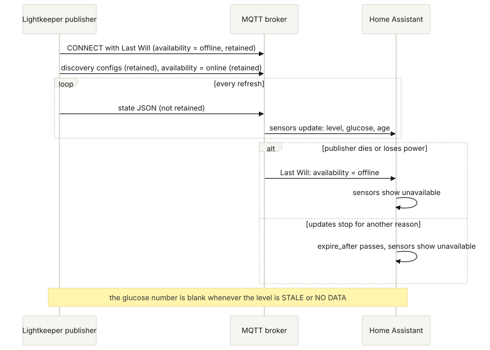

# Setup

Everything needed to reproduce the Lightkeeper stack from scratch, in the order to do it. Part 1 is the developer workstation. Part 2 is the therapy half (Nightscout, Trio), which belongs to the person with diabetes and their care team; we link to the community docs for those steps because they change often, and note only our own choices. Part 3 is each Lightkeeper display, the desktop window among them. Part 4 is the iOS app, and Part 5 the Android app.

Lightkeeper is a secondary display and not a medical device. Always confirm on the primary CGM app.

## Part 1: Developer workstation

### IDE Setup

This project follows Eric's Engineering Constitution. Open the repository in VS Code, Visual Studio, a JetBrains IDE, or Claude Code from the project folder; the committed instruction files (`AGENTS.md`, `CLAUDE.md`) apply the constitution automatically. After cloning, run `git submodule update --init --recursive` so `constitution/` is present. See `docs/HELP.md` and `constitution/INTEGRATION.md`.

### Supported Platforms

- Windows: Windows 11, PowerShell 7
- macOS: macOS 14+ (optional; Trio and the iOS app build in the cloud, so no Mac is needed)
- Linux: Ubuntu 22.04+ and Raspberry Pi OS Bookworm (display builds)
- CI runs on Ubuntu (Python, firmware, governance) and macOS (iOS).

### Prerequisites

Python 3.11 or newer, Git, and for the firmware host tests a C++17 compiler and make. Node.js 20 or later runs the demo's panel tests (they skip without it locally), and PlatformIO 6.2.0 is needed only to build the ESP32 device skeleton. The desktop window needs Tk, which the python.org installers for Windows and macOS include; on Debian, Ubuntu and Raspberry Pi OS install `python3-tk`, and Homebrew's `python@3.12` needs `python-tk@3.12`. Building the Android app needs JDK 17 or 21 and the Android SDK (Part 5).

<details>
<summary>Windows (PowerShell)</summary>

```powershell
winget install --id Python.Python.3.12 -e
winget install --id Git.Git -e
# The python.org installer includes Tk, for the desktop window.
# Firmware host tests need g++ and make with AddressSanitizer: use WSL (Ubuntu), since
# MinGW toolchains (MSYS2, WinLibs, Git Bash) cannot link AddressSanitizer.
# Run them with: wsl -- make -C firmware/xteink test
winget install --id MSYS2.MSYS2 -e
```

</details>

<details>
<summary>macOS (zsh)</summary>

```bash
brew install python@3.12 git
xcode-select --install   # provides clang++ and make
brew install python-tk@3.12   # only for the desktop window
```

</details>

<details>
<summary>Linux / Raspberry Pi (bash)</summary>

```bash
sudo apt update && sudo apt install -y python3 python3-venv git g++ make clang-format
sudo apt install -y python3-tk   # only for the desktop window
```

</details>

### Verify Prerequisites

```bash
python tools/doctor.py   # use python3 on macOS/Linux
```

It checks Python 3.11+, the constitution submodule, the test and lint tools, and the C++ toolchain, and names exactly what's missing. Run it again after installing (next step) to confirm the dev tools.

### Installation

```bash
git clone --recurse-submodules https://github.com/esanacore/lightkeeper
cd lightkeeper
```

<details>
<summary>Windows (PowerShell)</summary>

```powershell
py -3.12 -m venv .venv
.\.venv\Scripts\Activate.ps1
pip install -e ".[dev]" pre-commit
pre-commit install; pre-commit install --hook-type pre-push
```

</details>

<details>
<summary>macOS / Linux (bash or zsh)</summary>

```bash
python3 -m venv .venv
source .venv/bin/activate
pip install -e ".[dev]" pre-commit
pre-commit install && pre-commit install --hook-type pre-push
```

</details>

### First Run

```bash
python -m lightkeeper --demo                 # IN RANGE with canned data
python -m lightkeeper --demo --demo-minutes-ago 40   # the STALE screen
python -m lightkeeper --demo --watch         # the logbook frame in a terminal; Ctrl+C to stop
python -m lightkeeper.desktop --demo         # the panel in a desktop window (needs Tk); q to quit
python -m pytest --cov                       # full suite, 100% coverage
make -C firmware/xteink test                 # firmware rules under sanitizers
node --test web/panel/panel.test.mjs         # the demo's panel port (Node 20 or later)
```

### Environment Variables

There is no `.env` loader; set variables in your shell or service definition. `.env.example` lists them all with safe defaults, and `docs/ENV_VARS.md` describes each one.

<details>
<summary>Windows (PowerShell)</summary>

```powershell
$env:NIGHTSCOUT_URL = "https://ns.example.com"
$env:NIGHTSCOUT_TOKEN = Read-Host "Readable token"
python -m lightkeeper
```

</details>

<details>
<summary>macOS / Linux (bash or zsh)</summary>

```bash
export NIGHTSCOUT_URL="https://ns.example.com"
read -rs NIGHTSCOUT_TOKEN && export NIGHTSCOUT_TOKEN
python -m lightkeeper
```

</details>

## Part 2: The therapy half (Nightscout and Trio)

These steps are the person with diabetes's decisions, made with their care team. Phases and exit criteria are in `docs/ROADMAP.md`.

### Phase 1: Nightscout

Nightscout is the data hub every Lightkeeper display reads from. Host it somewhere the phone can reach from anywhere, which means a cloud VPS or a managed Nightscout host, not a machine at home.

1. Pick hosting (see "Choosing a host" below) and record the choice in a new ADR (`docs/adr/`).
2. Follow the official install guide at nightscout.github.io for the host you chose. Use the Docker Compose method on a VPS: it gives you Nightscout, MongoDB, and automatic HTTPS via a reverse proxy.
3. Security settings that are not optional for us: a long random `API_SECRET` (at least 24 characters, generated, never reused), `AUTH_DEFAULT_ROLES=denied` so nothing is public, and HTTPS only.
4. Create the read-only token: in Nightscout, open the hamburger menu, Admin Tools, Subjects, add a subject named `lightkeeper-displays` with the role `readable`. The token Nightscout shows is what every display uses as `NIGHTSCOUT_TOKEN`. Never put the `API_SECRET` on a display.
5. Backups (VPS only; managed hosts do this for you, so just note their retention): schedule a nightly `mongodump` to object storage and restore it once to a scratch instance to prove it works. Record the retention period in `docs/OPERATIONS.md`.
6. Verify from a workstation: `NIGHTSCOUT_URL=https://your-site NIGHTSCOUT_TOKEN=... python -m lightkeeper` should print NO DATA until an uploader exists, not a configuration error.

#### Choosing a host

Checked 2026-10-25 on each provider's own pages; prices move, so re-check before paying. The one hard requirement for Lightkeeper is the ability to set `AUTH_DEFAULT_ROLES=denied` and create a `readable` subject token (steps 3 and 4).

| Option | Cost per month | Who does upkeep | `AUTH_DEFAULT_ROLES` and readable tokens | Notes |
| --- | --- | --- | --- | --- |
| [ElfHosted](https://store.elfhosted.com/product/nightscout/) (managed) | $9 ($7.20 paid yearly; $1 seven-day trial) | Host: updates, TLS, nightly database backups | Yes, in [their docs](https://docs.elfhosted.com/app/nightscout/) | Private by default; data region not stated; Discord support |
| [ns.10be.de](https://ns.10be.de/en/pricing.html) (managed) | €5.99 (€59.99 a year) | Host: updates, TLS, backups every 4 to 6 hours kept 47 days; small updates need a manual redeploy | Custom env vars supported; confirm `AUTH_DEFAULT_ROLES` with support first | Servers in Germany; 99.0% uptime guarantee |
| [T1Pal](https://www.t1pal.com/) (managed) | from $11.99 | Host | Not confirmed (sharing uses secret links) | Ask before buying |
| [Nightscout Pro](https://nightscout.pro/) (managed) | about £3 to £4 | Host, follows official releases | Not confirmed | Pricing page inconsistent |
| VPS with the [official Docker Compose setup](https://nightscout.github.io/vendors/VPS/docker/) (DigitalOcean 1 GiB, Hetzner) | about $6 to $8 including provider backups | You: OS patches, image updates, backups, MongoDB upgrades (about an hour a month) | Full control | You pick the data region; allow 10 GB or more of disk, since Trio's device status grows the database |
| Oracle Always Free VM | $0 | You | Full control | Oracle may reclaim idle instances |
| Railway, Fly.io, Heroku Eco | about $5 plus a MongoDB | Mostly you | Yes | Free tiers are gone; Railway has trouble with some follower apps |

Do not use these for a closed loop: Render's free tier (sleeps after 15 minutes), Azure F1 (60 CPU minutes a day, not recommended for loopers by the Nightscout docs), Northflank's free tier (throttled), or a MongoDB Atlas M0 database (512 MB; Nightscout crashes when it fills).

Recommendation: ElfHosted for the lowest upkeep, since it is the only managed host whose documentation confirms both settings Lightkeeper needs. Use the trial to check that a readable token works from a display over HTTPS before pointing Trio at it. Runner-up: a VPS with Docker Compose, which this guide already describes, for full control and a data region you choose. ns.10be.de is a cheaper EU option once support confirms `AUTH_DEFAULT_ROLES`.

### Phase 2 and 3: Trio

Trio is the open source automated insulin delivery app that runs on the iPhone and talks to the pump. It is not Lightkeeper code. Read triodocs.org end to end first, and talk with the endocrinologist before starting.

Our specific choices:

- Build method: Trio's **browser build** (GitHub Actions to TestFlight). No Mac is needed. It requires a paid Apple Developer account (in place) and follows triodocs.org's "Build with Browser" guide exactly, including the GitHub secrets it asks for. Keep the fork's default branch on `main`.
- CGM: Dexcom G7 via the Dexcom G7 app on the same phone. Turn off iOS automatic app updates, and update the Dexcom app only after the Trio community confirms compatibility. The first G7 sensor session must start in the country of the App Store the Dexcom app came from.
- Pump: Omnipod 5 pods, supported on Trio's main branch since v1.0.0 (September 15, 2026). Switching steps are on the Omnipod 5 compatibility page at nightscout.github.io/omnipod-five. Keep a backup DASH pod for the first switch, do not fill a new pod until Trio shows the pairing screen, and have internet for the first pod's certificate step.
- Nightscout: enter the site URL and the `API_SECRET` in Trio so it can upload (Trio writes; displays only read).
- Open loop first. Trio only suggests for at least two weeks while settings are validated with the care team. Closed loop when ADR-0002's promotion criteria are met.
- Keep the official Omnipod 5 app or Controller as a fallback: pairing a fresh pod with it restores the stock algorithm.

## Part 3: Displays

Hardware is in `docs/HARDWARE.md`. Each display reads Nightscout with the readable token and nothing else.

### Bedside e-ink display (Raspberry Pi Zero 2 WH + 2.9" e-paper HAT)

1. Flash Raspberry Pi OS Lite (64-bit, Bookworm) with Raspberry Pi Imager. In the imager's settings set the hostname (`lightkeeper-bedside`), enable SSH, set a user, and enter the Wi-Fi.
2. Boot, SSH in, and enable SPI: `sudo raspi-config` → Interface Options → SPI → Yes. Reboot.
3. Install the project for a dedicated, unprivileged service user, from a release tag (v0.2.0 or later includes `deploy/`; use the newest tag from the Releases page):

   ```bash
   sudo apt update && sudo apt install -y python3-venv git
   sudo useradd --system --no-create-home --shell /usr/sbin/nologin lightkeeper
   sudo git clone --branch v0.2.0 --recurse-submodules https://github.com/esanacore/lightkeeper /opt/lightkeeper/src
   sudo python3 -m venv /opt/lightkeeper/venv
   sudo /opt/lightkeeper/venv/bin/pip install /opt/lightkeeper/src
   ```

4. Put the settings in `/etc/lightkeeper.env`, readable by root only (systemd reads it before dropping privileges):

   ```bash
   sudo install -m 600 /dev/null /etc/lightkeeper.env
   sudo tee /etc/lightkeeper.env >/dev/null <<'EOF'
   NIGHTSCOUT_URL=https://your-site.example
   NIGHTSCOUT_TOKEN=paste-the-readable-token
   LK_STALE_MINUTES=15
   EOF
   ```

5. Install and start the service from `deploy/lightkeeper.service`. It runs `--watch` as the `lightkeeper` user inside systemd's sandbox, writes `/run/lightkeeper/screen.svg` and `status.json`, and uses systemd's watchdog: every finished refresh checks in, and a refresh that hangs gets the service restarted instead of leaving a frozen screen. `systemctl stop` sends SIGINT, so the clean shutdown runs (Home Assistant sees `offline`). Until the e-paper driver (FR-007) lands, the service writes the SVG; the driver will draw straight to the panel.

   ```bash
   sudo install -m 644 /opt/lightkeeper/src/deploy/lightkeeper.service /etc/systemd/system/
   sudo systemctl daemon-reload && sudo systemctl enable --now lightkeeper
   systemctl status lightkeeper      # the Status: line shows the current level
   journalctl -u lightkeeper -f
   ```

   To upgrade later: `sudo git -C /opt/lightkeeper/src fetch --tags && sudo git -C /opt/lightkeeper/src checkout <new tag>`, then rerun the `pip install` line and `sudo systemctl restart lightkeeper`. Read the release notes first.

   If you change `--interval`, keep `WatchdogSec` above two intervals plus about 30 seconds. `systemd-analyze security lightkeeper` should report an exposure level around 1.2 ("OK").

6. Validate before anyone relies on it: run it beside the primary app for one full sensor session and log every mismatch, freeze, or missed STALE (the manual validation step in `docs/TEST_PLAN.md`).

### Pocket display (Xteink X4 Pro) and the bench board

The firmware rules, the JSON parser and the panel rasterizer are done and tested on a PC (`firmware/xteink`), and a build-only skeleton for the bench board (`bench_s3`) and the X4 (`x4`) prints the NO DATA panel over USB serial; Wi-Fi and the panel driver are the next firmware milestone (FR-010). Build it with `cd firmware/xteink && pio run -e bench_s3 -e x4` (PlatformIO 6.2.0; install it with the VS Code extension on Windows or `pip install platformio==6.2.0`). Before the first upload to the bench board, check its flash size and mode: the build assumes 8 MB of qio flash, the board definition's default (`firmware/xteink/README.md`, "Build and flash the device skeleton"). Buy the bench board from `docs/HARDWARE.md` and study WaveshareMon for Wi-Fi, TLS, and e-paper refresh patterns. Flashing steps for the Xteink will be written with the device build; read CrossPoint's flashing and recovery guides first and back up the SD card.

### Home Assistant

Lightkeeper publishes its status to Home Assistant over MQTT discovery (FR-008, ADR-0010). Home Assistant's own Nightscout integration shows the raw last number and does not know when it is stale; Lightkeeper's level does.

1. Install the Mosquitto broker add-on and enable the MQTT integration in Home Assistant.
2. Create a broker user for Lightkeeper, and limit it in the broker's ACL to `lightkeeper/#` and `homeassistant/sensor/<node id>/#`.
3. Give the broker a certificate for TLS (the Mosquitto add-on supports it), or run Lightkeeper on the same machine as the broker and set `LK_MQTT_TLS=false` with `LK_MQTT_HOST=localhost`; plain MQTT to any other host is refused.
4. Set `LK_MQTT_HOST`, `LK_MQTT_USERNAME`, `LK_MQTT_PASSWORD`, and `LK_MQTT_NODE_ID` (one per display; see `docs/ENV_VARS.md`) and run `python -m lightkeeper --watch`. Four sensors appear under a device named "Lightkeeper", or "Lightkeeper (<node id>)" when `LK_MQTT_NODE_ID` is not the default: Glucose level (an enum of the seven levels), Glucose (mg/dL), Glucose reading age, and Last reading (when the last reading was taken).



How it stays honest (HAZ-013): the glucose number is blank (unknown) whenever the level is STALE or NO DATA; state is never retained, so a Home Assistant restart shows unknown until the next refresh rather than replaying an old level; and if the publisher stops, the entities go `unavailable`, within about three refresh intervals at most.

Example automation. These are secondary alerts you choose to add; the primary app's alarms stay the ones to rely on:

```yaml
automation:
  - alias: "Lightkeeper: urgent low"
    triggers:
      - trigger: state
        entity_id: sensor.lightkeeper_glucose_level
        to: "URGENT LOW"
    actions:
      - action: notify.notify
        data:
          message: "Lightkeeper shows URGENT LOW. Check the primary CGM app now."
  - alias: "Lightkeeper: not current"
    triggers:
      - trigger: state
        entity_id: sensor.lightkeeper_glucose_level
        to: ["STALE", "NO DATA", "unavailable"]
        for: "00:05:00"
    actions:
      - action: notify.notify
        data:
          message: "Lightkeeper has no current reading. Check the primary CGM app."
```

Entity ids depend on the device and sensor names; check them under Settings, Devices. `--json PATH` writes the same status as a file, for dashboards that read files. With a non-default node id, a new install's entity ids include it (for example `sensor.lightkeeper_bedside_glucose_level`). Entities created before this release keep their ids, because the unique ids did not change.

### Desktop window

`python -m lightkeeper.desktop` opens a window that shows the real e-paper panel, the same pixels `--png` writes, on any computer whose Python has Tk (FR-018). It reads the same `NIGHTSCOUT_URL`, `NIGHTSCOUT_TOKEN` and `LK_*` thresholds as the CLI and fetches every 60 seconds.

```bash
python -m lightkeeper.desktop --demo                        # canned reading, no network
python -m lightkeeper.desktop --scale 3 --on-top
python -m lightkeeper.desktop --panel 800x480 --theme dark
```

`r` checks Nightscout now, `t` switches between the pixels and the lines as text, and `q` (or the close box) quits. `--scale` (2 or 3) counts 96 dpi pixels, so on a display scaled to 200% each panel pixel is drawn as 4x4 device pixels at `--scale 2`; when the window would not fit the screen, the zoom drops to the largest whole number that fits and one line on stderr says so. `--theme auto` follows the Windows app theme, read once at startup, and is light elsewhere; `--theme dark` draws the panel in Night paper and Night ink for the bedside. Installed with `pip install`, `lightkeeper-window` opens the same window with no console window on Windows (D12, pending Eric's review); with no console it cannot print a configuration error, so try `python -m lightkeeper.desktop` in a terminal first. It has been checked by hand on Windows 11 only; macOS and Linux with a display are still to check (GAP-015). Run it beside the primary app before relying on it, as for any display.

## Part 4: The iOS companion app

Source is in `apps/ios/` (read `apps/ios/README.md`). The read-only layer builds and tests on GitHub's macOS runners on every change, so no Mac is required.

1. Development: edit Swift files in any editor; push; `.github/workflows/ios.yml` runs the shared-vector tests and builds the app.
2. Installing on a phone: TestFlight through the paid Apple Developer account. The signing and upload steps mirror Trio's browser build (App Store Connect API key stored as GitHub secrets); they are added to `ios.yml` when the first TestFlight build is cut, and documented here at that point.
3. In the app: on first launch a card says "Add your Nightscout site to start"; open Settings and enter just the site (`https://your-site.example`, nothing after the name: no path, query, fragment or login). The address is checked as you type, and Save stays off until it can be used. Add the **readable** token (it goes to the Keychain), made in Nightscout's Admin Tools, Subjects (Part 2, step 4). Check connection makes one read-only request and says what happened: connected, with how old the newest reading is; Nightscout refused the token; this Nightscout needs a token to be read (the token field is empty); the site could not be reached; or the site answered, but not the way Nightscout does. Thresholds step by 5 (urgent low 40 to 100, low 45 to 150, high 100 to 350, urgent high 105 to 400) with Reset to defaults; Stale after runs from 6 to 60 minutes and shows a caution above 15. Thresholds change only which word the display shows. They do not affect dosing or the primary app's alarms. Match them to the alert settings already in the primary app.

## Part 5: The Android companion app

Source is in `apps/android/` (read `apps/android/README.md`). It is a read-only app built in Kotlin over the firmware's own C++ rules (FR-020), shipped for now as a sideloaded debug APK.

1. Prerequisites: JDK 17 or 21 and the Android SDK with platform 36, NDK 28.2.13676358 and CMake 3.22.1; point Gradle at the SDK with `ANDROID_HOME` or a `local.properties` file (`sdk.dir=...`, not committed). On Windows keep the checkout path to about 60 characters or fewer, such as `C:\src\lightkeeper`: from a long path the native build fails with `ninja: error: mkdir(...)` (`apps/android/README.md`, Build and install).
2. Build and test:

   <details>
   <summary>Windows (PowerShell)</summary>

   ```powershell
   cd apps\android
   .\gradlew.bat assembleDebug testDebugUnitTest lint
   ```

   </details>

   <details>
   <summary>macOS / Linux (bash or zsh)</summary>

   ```bash
   cd apps/android
   ./gradlew assembleDebug testDebugUnitTest lint
   ```

   </details>

3. Install: turn on USB debugging in Developer options and run `adb install -r app/build/outputs/apk/debug/app-debug.apk`, or copy the APK to the phone and open it (Android asks once to allow installs from that app). The phone needs Android 8.0 (API 26) or later.
4. In the app: a card says "Add your Nightscout site to start"; in Settings enter just the site (`https://your-site.example`) and a **readable** token, which is sealed with a key in the Android Keystore. The thresholds step by 5 and Stale after runs from 6 to 60 minutes with a caution above 15, as on iOS. There is no Check connection yet: a failed fetch shows as `Nightscout unreachable`. Thresholds change only which word the display shows. They do not affect dosing or the primary app's alarms. Match them to the alert settings already in the primary app.
5. Not a release: there is no store listing or release signing, and the app has run only on emulators, never on a phone. In CI, `.github/workflows/android.yml` builds it and its unit tests and lint pass; its first emulator run passed 38 of the 39 instrumented tests (the one that failed needs a wider screen than the default emulator's), and the rerun on a phone-sized emulator is pending (GAP-013). Validate it beside the primary app before relying on it.

## Checking the whole stack

Run through `docs/DISPLAY_STATES.md` with the real system: fresh reading, a sensor warm-up, the phone out of Bluetooth range, the phone offline, and Nightscout stopped. Every display must show STALE or NO DATA within the stale limit, with no number that looks current. Record what you saw in `docs/TEST_PLAN.md`'s coverage table.
