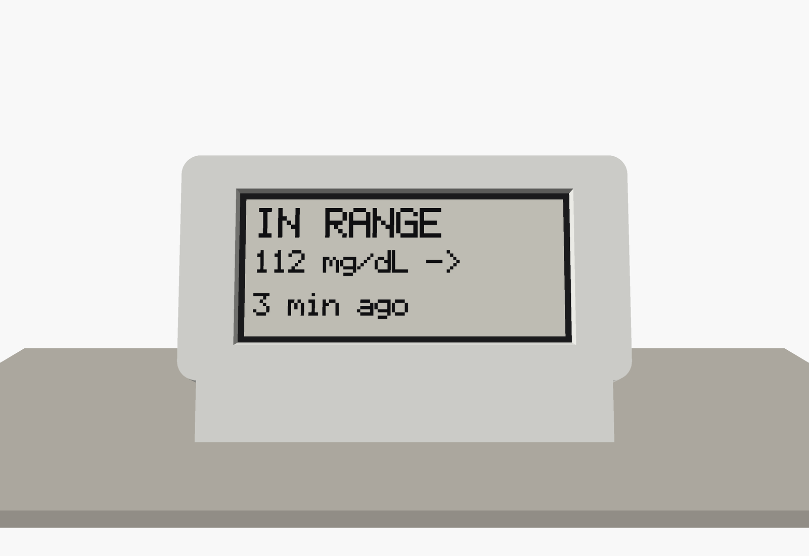
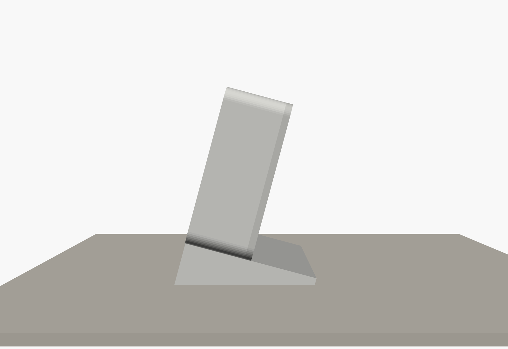
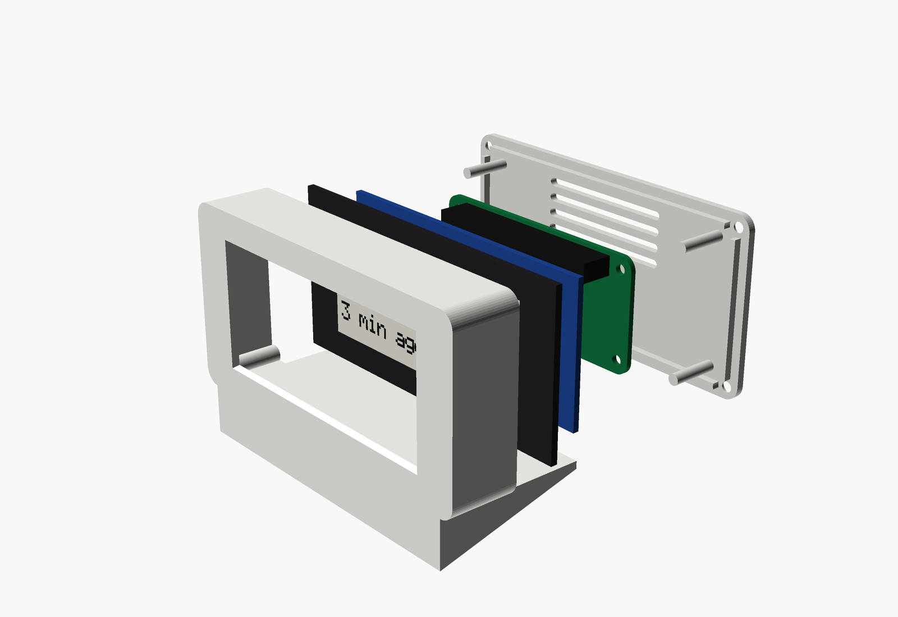

# Hardware

Everything physical for Lightkeeper's displays: what to buy and the printed enclosure.


## Contents

- `bom/bom.csv`: the bill of materials, one row per part, grouped by build. `python tools/gen_bom.py` turns it into `docs/BOM.md`.
- `enclosure/bedside.scad`: the parametric OpenSCAD model of the bedside enclosure (a front bezel with a 15 degree plinth, and a back cover). Every dimension names its source; the few the official drawings do not give are marked `VERIFY`.
- `enclosure/stl/`: the two parts, exported ready to print with no supports.
- `enclosure/renders/`: documentation images (assembled, front, back, side, two exploded views).
- `enclosure/screen_in_range.scad`: the screen shown in the renders, generated from the real rasterizer.
- `enclosure/manifest.json`: hashes of the inputs the renders and STLs were made from, so a test catches a model change without a re-render.

## Where to go next

- What to buy and why: `docs/HARDWARE.md`; prices and stock: `docs/BOM.md`.
- How to print and assemble: `docs/ASSEMBLY.md`.
- How to install the software on the Pi: `docs/SETUP.md`, "Bedside e-ink display".

## Regenerating

```bash
python tools/gen_bom.py            # docs/BOM.md from bom/bom.csv
python tools/render_enclosure.py   # renders, STLs, manifest (needs OpenSCAD and Pillow)
```

| Front | Side | Exploded |
| --- | --- | --- |
|  |  |  |
