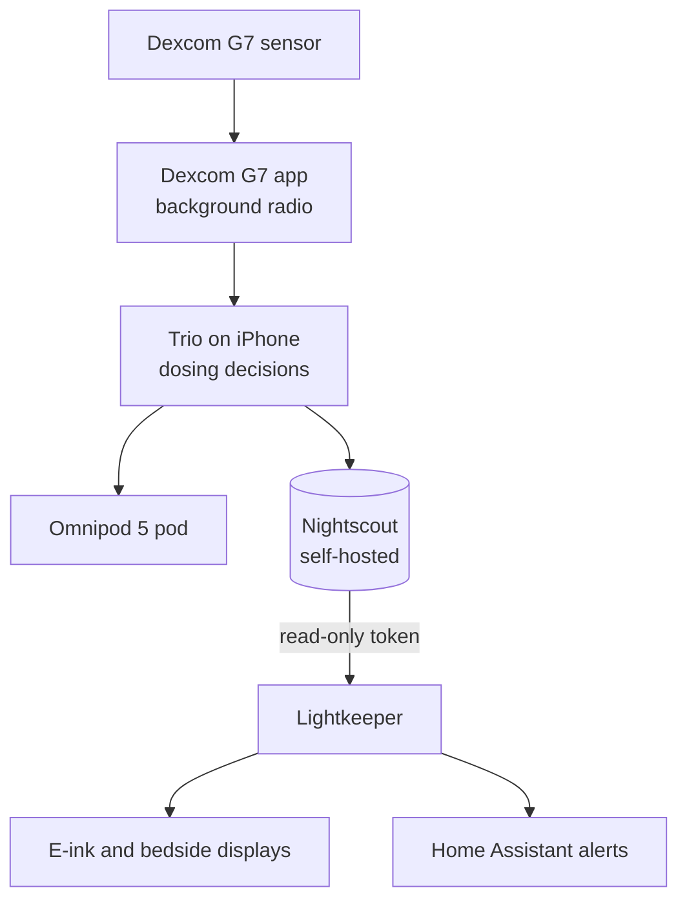

# How It Works

The top half is community software on Kaitlin's iPhone. Trio reads the sensor through the Dexcom app, decides insulin doses, commands the pod, and uploads everything to Nightscout. Lightkeeper's code lives entirely below Nightscout: it reads the newest reading over HTTPS, checks that it can be trusted, decides what to show, and draws it.

## Inside Lightkeeper

- **Domain rules** (pure logic, no network or clock): parse entries, reject anything untrustworthy, classify the reading, and apply the staleness rule first.
- **Application**: fetch, classify, and render a few short lines; if Nightscout fails, let the last reading age into STALE.
- **Infrastructure**: the HTTPS Nightscout client and the SVG panel renderer.
- **Firmware**: the same rules in C++ for an Xteink pocket e-ink reader, kept identical to the Python by a shared set of test cases (`spec/display_vectors.json`).

The detailed version, with decisions and their reasons, is `docs/ARCHITECTURE.md` and `docs/adr/` in the repository.

Back to [[Home]], or see [[Safety]].
