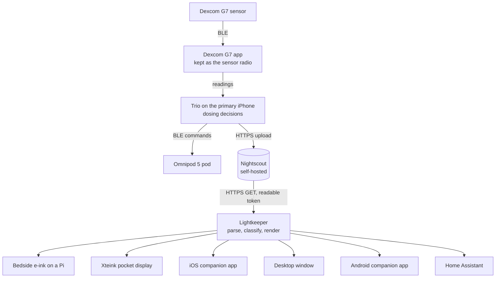

# How It Works

The whole stack has two halves with a one-way boundary between them. The therapy half is community software on the primary iPhone, the one the person with diabetes carries. The display half is this repository. Data flows from the first into the second and never back.

Everything above Nightscout is configured, tested, and contributed to upstream, but none of its code lives here. Everything below Nightscout is Lightkeeper. The diagram is simplified: each phone app and the pocket display fetch from Nightscout themselves, with the same rules. The detailed version, with the component diagram and the layer table, is `docs/ARCHITECTURE.md` in the repository.

## The data flow, step by step

1. The Dexcom G7 sends a reading every five minutes to the Dexcom G7 app. On iPhone, Trio reads that value from the same phone, which is why the Dexcom app stays installed as a background radio.
2. Trio runs its algorithm, commands the pod, and uploads glucose entries, insulin, and loop status to Nightscout.
3. `lightkeeper` requests the newest entries from Nightscout's `/api/v1/entries/sgv.json` endpoint over HTTPS, with a token that has only the readable role. It asks for twelve entries, never more than 288, and only ever issues GET.
4. The domain layer parses each entry and drops anything untrustworthy: a type other than `sgv`, a missing, fractional, non-finite, or out-of-range value (39 to 401 mg/dL), a timestamp outside 2000 to 2100. Nothing is repaired, and one poisoned entry never discards its neighbors (HAZ-011). The newest valid reading wins; two readings with the same timestamp resolve to the lower value.
5. The domain layer classifies that reading against the current time. Staleness comes first: older than the stale limit (15 minutes by default) or more than 2 minutes in the future means STALE, regardless of the value. Only a fresh reading is compared against the thresholds.

   

6. The application layer renders three or four short ASCII lines and the CLI returns an exit code. If the fetch failed, the last good reading is re-classified against the current time, so it ages into STALE instead of freezing on screen, and the last line says "Nightscout unreachable". The same status can be written as SVG, JSON, PNG or BMP and published to Home Assistant; under systemd, each finished cycle also pets the watchdog, so a hung cycle is restarted rather than left frozen.

Glucose data is classified Restricted at every step, and the token is Confidential. [[Security and Privacy]] has the classification table and the threat model.

## Layer boundaries

The Python package has three layers with dependencies that point inward only. A constitution CI check (`constitution-architecture.yml`) fails the build if an import crosses the wrong way.

| Layer | Path | May depend on | What lives there |
| --- | --- | --- | --- |
| domain | `src/lightkeeper/domain/` | nothing | `glucose.py` (parsing, `Trend`, `GlucoseReading`) and `status.py` (`Thresholds`, `Level`, `classify`). No I/O, no clock, no network. |
| application | `src/lightkeeper/application/` | domain | `monitor.py`: `current_status` (fetch, parse, classify, degrade) and `render_lines`; `spoken.py` (the spoken form), `status_payload.py` (the `--json` and Home Assistant payload), and `glance.py` (the desktop window's glance: when to fetch, re-age and redraw, on a clock it is given). |
| infrastructure | `src/lightkeeper/infrastructure/` | domain | `nightscout.py` (the HTTPS client), `svg_display.py` and `epaper_bitmap.py` (the panel renderers), `panel_layout.py` and `panel_profiles.py` (the integer-only panel layout and its six sizes), `terminal_view.py` (the `--watch` frame), `mqtt.py` and `home_assistant.py` (publishing to Home Assistant, ADR-0010), `systemd_notify.py` (the service watchdog), and `tk_window.py` and `ppm.py` (the desktop window, which is handed the `tkinter` module rather than importing it, and the panel's pixels as an image Tk can show). |
| composition root | `src/lightkeeper/cli.py`, `config.py` and `desktop.py` | all of the above | Reads and checks the environment once, builds the client and thresholds, runs the loop or the window. Only `desktop.py` imports `tkinter`, and only when the window opens. |

The domain layer takes `now` as an argument rather than reading a clock, which lets every safety rule be tested with plain data and a fixed time.

## The four places the rules live

Display behavior is implemented more than once because the targets cannot share a runtime: a Raspberry Pi runs Python, an ESP32-C3 cannot, and an iPhone wants Swift. Four artifacts must agree.

1. **Python**, `src/lightkeeper/domain/`. The reference implementation and the one the bedside display runs.
2. **C++17**, `firmware/xteink/lib/glucose_rules/`. A line-for-line port with fixed-size buffers and no heap, for the Xteink pocket reader. Function names mirror the Python (`parse_entry`, `classify`, `render`) so reviewers can read the two side by side. See [[Firmware]].
3. **Swift**, `apps/ios/LightkeeperCore/`. The same rules and a read-only Nightscout client for the companion app. See [[Companion App]].
4. **The shared vectors**, `spec/display_vectors.json`. Thirty-nine cases, each one raw Nightscout entry (or none) or a list of entries, each entry with its age in minutes or seconds, optional custom thresholds, an optional fetch error, and the exact expected level and lines. The Python suite, the C++ host tests, and the Swift XCTest target all run every case, must render identical output, and assert the file's `spec_version`.

The Android app adds no fifth: it compiles the C++ rules in place and runs every vector through them on the phone. The desktop window is Python, so it runs the reference rules unchanged.

The panel's pixels have their own shared file. `spec/panel_vectors.json` pins every vector's 1-bit panel at six sizes, and the Python reference (on the Pi and in the desktop window), the C++ rasterizer (the ESP32 and the Android app) and the demo's JavaScript port all draw the same pixels, so STALE is never weaker on one device than another. The spoken sentences follow the vectors in `spec/spoken_vectors.json`.

The vectors are the source of truth. A rule change touches the three implementations and the vectors in the same commit, then `python tools/gen_display_gallery.py` regenerates the gallery in `docs/DISPLAY_STATES.md` and the demo page from the same file. That is how parity is enforced by tests rather than by discipline, and the vectors have already caught real divergences. [[Testing and Quality]] describes the parity check, and [[Contributing]] the one-commit rule.

## What the renderer promises

Every screen is at most four lines of plain ASCII, sized for a 296 by 128 pixel panel. Fresh readings show the level, the value with a trend arrow, and the age. STALE leads with "STALE - DO NOT TRUST", then the last value, its age, and "Confirm on primary device". Sentinels render as words, never numbers. The SVG version adds a "written HH:MM UTC" stamp so a dashboard can tell a live writer from a dead one. Exported PNG and BMP panels carry a local `HH:MM` stamp of when they were drawn. The desktop window shows the same panel pixels, enlarged by a whole number and stamped with the local `HH:MM` at each redraw, and the Android app draws them with the C++ rasterizer beneath its glance. Every screen is pictured in [[Display States]].

Back to [[Home]], or continue to [[Safety]].
